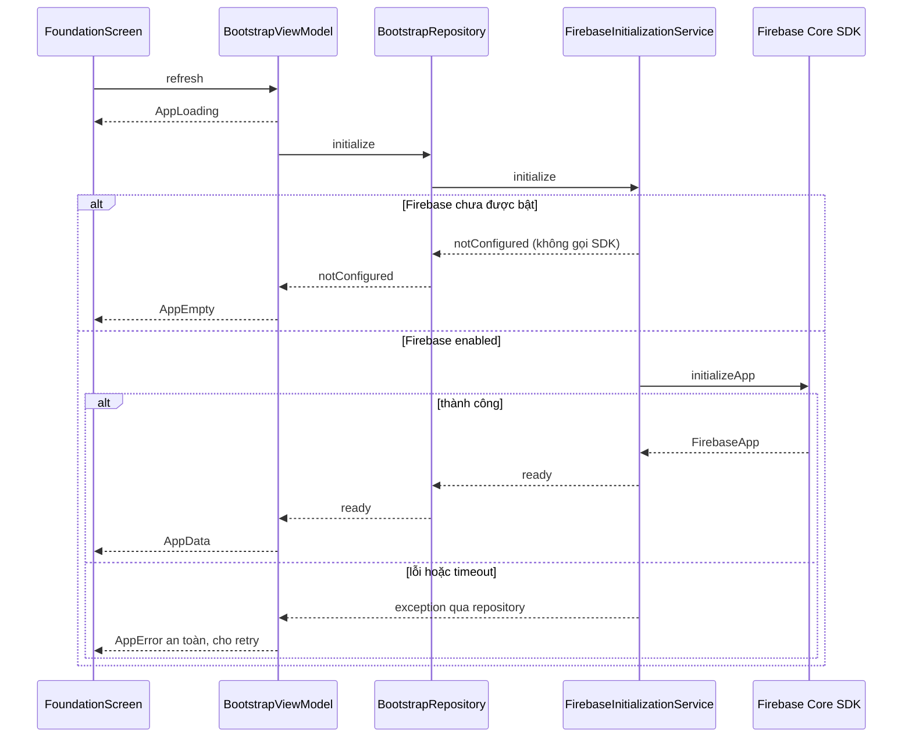
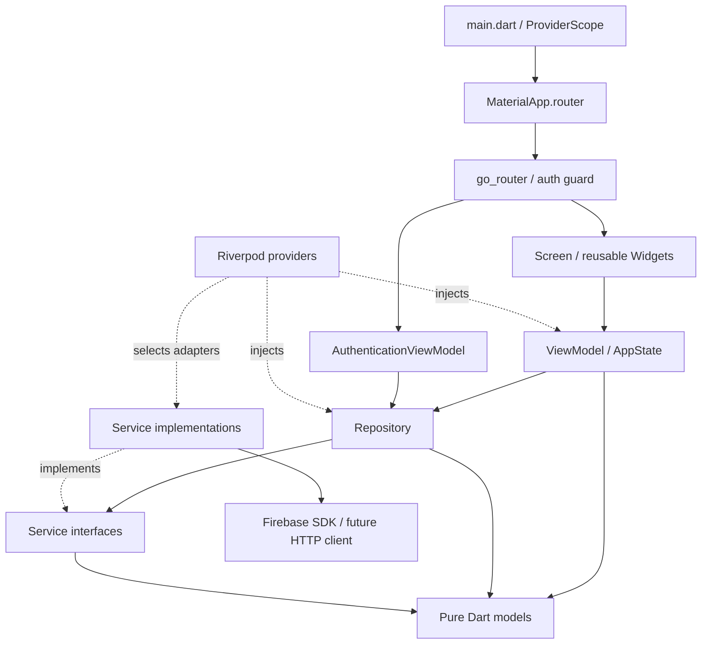

# Kiến trúc source base

> **Interests — 09/11/2026:** danh sách presentation dùng chung ở onboarding và
> Profile gồm 10 danh mục. `EviaViewModel.interestIds` ánh xạ tên tiếng Anh sang
> ID catalog hiện có, nên các lựa chọn đã lưu vẫn được khôi phục và chỉnh sửa.
> Thay thế giới hạn 8 thẻ/Gaming và Environment pending trong ghi chú 05/11.

> **Evibaby — 09/11/2026:** Chat → EvibabyViewModel → EvibabyRepository →
> BackendService/FirebaseBackendService → callable `chatWithEvibaby` → DeepSeek.
> Tools server chỉ đọc public catalog/detail và guide được duyệt; card lấy từ
> record canonical sau kiểm ID. Secret ở server, quota transaction riêng,
> chat/context chỉ trong RAM và reset theo account. [Contract](evibaby-chat.md).

> **QR Walk-in để in:** Evia Admin gọi `getAdminWalkInQr` và tạo PNG trên trình
> duyệt. Mã cố định nằm trong `checkin_tokens`, chỉ máy chủ có quyền truy cập
> trực tiếp. App dùng `ActivityViewModel` → `Flow1Repository` → `BackendService`
> để gọi `verifyWalkInQr`, kiểm tra giờ sự kiện và cập nhật điểm danh/ví trong
> cùng giao dịch.

> **Gửi thông báo Vite admin:** `notifications.js` điều phối form/retry/session, `firebase.js` gọi callable `sendAdminNotification`. Backend kiểm quyền/recipient và ghi inbox idempotent; trigger FCM và điều hướng inbox của mobile giữ nguyên. [Contract](ADMIN_NOTIFICATIONS.md).

> **Admin event editor — 06/11/2026:** `editor.js` dựng form/ràng buộc trạng thái; `catalogEntry` bổ sung technical defaults, giữ hidden fields khi sửa; Firebase adapter quản lý Storage upload/progress/URL. Cloud Rules giới hạn active admin và prefix event-images, đọc profile qua service agent. Mobile Storage adapter vẫn pending; không coi upload admin là tích hợp export/upload report trong app. [Chi tiết](ADMIN_EVENT_EDITOR.md).

> **Analytics — 06/11/2026:** View → ViewModel → AnalyticsRepository → AnalyticsService/FirebaseAnalyticsService; queue identity/events, schema allowlist và dedupe RAM. Xuất CSV: CoinHistoryScreen → ReportExportViewModel → ReportExportRepository → AndroidReportExportService → native document picker. [Contract và giới hạn](ANALYTICS_INTEGRATION.md).

> **Admin Flutter Web — 06/11/2026:** package độc lập `admin_flutter/` giữ
> View → Riverpod ViewModel → Repository → AdminService → SDK adapter.
> SDK bootstrap trong service, models thuần Dart, fakes chỉ trong tests.
> Một admin làm hết, không phân công staff. Server quyết định quyền, giờ check-in,
> capacity, stock, ví và receipt. [Hướng dẫn](../admin_flutter/README.md), [API](ADMIN_WEB_PLAN.md).

> **Push Android — 06/11/2026:** FirebaseMessagingService tạo kênh HIGH và hiển
> thị foreground FCM qua MethodChannel → Android NotificationManager. MainActivity
> chỉ host native bridge; payload/tap tiếp tục qua FlutterFire và ViewModel/router
> hiện có. Backend deliverPush giữ cleanup/retry và thêm log kết quả FCM theo ID.
> [Contract](PUSH_NOTIFICATIONS.md).

> **Flow 3 — 06/11/2026:** màn Rewards gốc → ActivityViewModel/Flow3ViewModel →
> Flow1Repository → BackendService/FirebaseBackendService. Flow3Snapshot giữ
> Daily, ví, catalog, ledger, milestones và receipts của account hiện tại.
> SDK vẫn chỉ ở service; loading/error/retry dùng widget hiện có. Auth/lifecycle,
> duplicate actions và khôi phục receipt nằm ở ViewModel. Các mô tả pending/
> preview của Rewards dưới đây là lịch sử. [Contract](FLOW3_INTEGRATION.md).
> **Evia Admin web.** Vite dùng Firebase Auth/callable cho catalog, thông báo,
> Analytics theo nguồn và Daily Check-in rewards. Backend kiểm quyền admin,
> ETag và đồng bộ policy Firestore. Crash QA dùng trình kiểm thử Windows cục bộ;
> xem [contract](REMOTE_CONFIG_PLAN.md), [Crash QA](EVIA_Crashlytics_Implementation.md).

> **Ticket cache fix — 05/11/2026:** ticket provider tạo event presentation từ
> response `getTicket`; View không dùng My Events cache để kết luận có vé hay
> chưa đăng ký. Cancel lookup nullable và error/loading dùng widgets hiện có.
> [Regression/evidence](../evidence/ticket-cache-fix/).

> **Flow 2 — 05/11/2026:** Activity/Profile ViewModels dùng Flow1Repository
> cho cancellation, Going, attendance và inbox; NotificationsViewModel giữ
> pagination/read/retry. PushNotificationsViewModel → PushNotificationRepository
> → MessagingService/FirebaseMessagingService + BackendService đăng ký FCM.
> SDK Messaging chỉ ở services; EventQrCamera chỉ camera presentation, không
> gọi backend. Server kiểm cờ demo, receipt và ownership cho nút debug.
> [Contract và evidence](../evidence/flow2-api-only/).

> **Email policy 05/11/2026:** client/server nhận mọi domain email đúng định dạng;
> validator dùng chung cho auth/profile/registration, MSSV và role guards giữ
> nguyên. Không thêm adapter/layer hoặc thay layout. [Contract](PREINTEGRATION_DECISIONS.md).

> **API-only theo owner 05/11/2026:** đã gỡ bộ màn `Flow1Screen` tạo ngoài phạm vi;
> nối Firebase vào các màn gốc, giữ layout/style/assets. Giữ 8 thẻ sở thích;
> Gaming/Environment chờ đội UI. Ảnh cũ làm minh họa khi chưa có URL; vé chỉ hiện
> QR trong ô cũ, chưa có mã dự phòng. [Phạm vi](API_INTEGRATION_PHASES.md) · [Evidence sửa lại](../evidence/flow1-api-only/).
> Các mô tả bộ màn live riêng/kết quả cũ bên dưới là lịch sử, không nghiệm thu bản này.


> **Flow 1 live — 05/11/2026:** [phạm vi mới](API_INTEGRATION_PHASES.md) thay thế
> ghi chú “chưa có adapter/chưa nối Flutter” phía dưới đối với Flow 1.
> View → Flow1ViewModel/RegistrationViewModel → Flow1Repository → BackendService
> → FirebaseBackendService; auth qua AuthenticationRepository/service adapter.
> Live bật với FIREBASE_ENABLED=true và không DEMO_AUTH. Dữ liệu demo live ở
> Firebase do owner yêu cầu; không import fixture business vào đường dữ liệu live.
> Các adapter khác, Flow 2/3 và instrumentation vẫn pending.

> **Dữ liệu demo live 05/11/2026:** [DEMO_DATA.md](DEMO_DATA.md) là dataset được
> owner cho phép tạo để nối SDK về sau. JSON và script nằm ở firebase/ và
> functions/scripts/, không import catalog demo vào Dart runtime. Operators
> được tạo ở Firebase Auth và app-role documents; credentials chỉ ở ignored
> local folder, không trong Firestore hoặc APK. Không có SDK adapter mới trong task.

> **Trước tích hợp 05/11/2026:** CampusRepository/CampusService bổ sung hai
> actions được yêu cầu: lưu onboarding và claim thành tựu. VM chỉ chuyển tiếp/
> cập nhật reward sau success của service; pending adapter ném lỗi rõ. Backend
> identity.ts dùng chung FPT policy; event_notifications.ts tách event trigger/
> scheduler khỏi SDK entry point để test logic với clock và Emulator.
> [Contract mới](PREINTEGRATION_DECISIONS.md) phân biệt source/UI contracts với
> concrete mobile adapters còn pending, không coi đây là nối ba flows hoàn tất.

> **Backend Event Milestones 05/11/2026:** module `functions/src/milestones.ts`
> compose vào createBackend, thêm 3 callables; API/policy tại
> [EVENT_MILESTONES.md](EVENT_MILESTONES.md). Firestore giữ definitions,
> aggregate attendance tính tiến độ; claim transaction ghi wallet/ledger/snapshot/
> receipt nguyên tử. Remote Config chỉ presentation. Flutter models/services/DI
> cho feature này chưa nối; task hiện tại không đổi UI demo đang phát triển.

> **Mô phỏng UI 05/11/2026:** debug + `DEMO_AUTH=true` hiện cho phép mô phỏng
> giữ/hoàn cọc, check-in, daily reward và đổi thưởng. `ActivityViewModel` quản lý
> presentation state tạm trong RAM từ fixtures đã được cho phép, không gọi backend.
> `/profile/demo` chỉ đăng ký khi cờ bật, cho mở 44 màn/trạng thái và reset ví 2.000 xu.
> Các mô tả “không mutation” phía dưới vẫn áp dụng khi cờ tắt; không dùng demo này
> làm evidence tích hợp thật. Xem hướng dẫn mới trong README.


> 05/11/2026: theo yêu cầu xem UI, thêm DemoAuthenticationService qua DI khi debug + DEMO_AUTH=true; mặc định vẫn pending. Login đi View → EviaViewModel → AuthenticationRepository → AuthenticationService, session stream cập nhật guard; logout xóa session. Không tích hợp Firebase Auth thật. Xem tài khoản/lệnh chạy trong README.


> **Release mới nhất 04/11/2026:** 34 Functions ACTIVE cùng hash source, 34 Cloud Run latest revisions READY; 2 Scheduler jobs ENABLED, timezone/IAM/target đã kiểm tra. [Release evidence](backend-release.md). Ghi chú 32 Functions hoặc local-only phía dưới là lịch sử trước release; UI/data/instrumentation vẫn pending.

> **Project hiện tại:** `prm393-31822` (evia, Blaze), theo yêu cầu chuyển của người dùng.
> App đã chuyển bằng FlutterFire; 32 Functions + Rules đã deploy, 14 indexes READY.
> API smoke cloud + 20 Emulator tests + APK/startup Core đạt; [evidence](firebase-migration.md).
> UI, Google login/push thật và dữ liệu catalog chưa tích hợp.
> Các mục về `evia-lab3-kiet-2026` bên dưới là lịch sử, không phải project để deploy tiếp.


## Backend nghiệp vụ độc lập — 04/11/2026

`functions/src/index.ts` nhận HTTPS Callable với Firebase Auth context →
`backend.ts` validate/dispatch → accounts/events/rewards/queries → Admin SDK
Firestore transactions. Monetary writes dùng receipt + ledger atomic; callable
không tin UID/role/giá trị tiền từ client. Rules từ chối mọi client mutation.
`catalog.ts` + create-only importer quản lý dữ liệu được duyệt, không seed giả.

Flutter vẫn giữ View → ViewModel → Repository → Service interface → SDK adapter.
Task này **không sửa Dart/UI**, không thay pending providers hoặc giả rằng UI đã
đăng nhập/gọi backend. Khi frontend sẵn sàng, thêm service adapter dùng callable
region asia-southeast1 và domain models theo [API v1](backend-integration.md),
đồng thời test state/error/auth guard. Auth credentials thuộc Firebase Auth SDK.

`firebase.json` cấu hình Auth/Firestore/Functions/Storage Emulators; tests chỉ
project demo loopback. Rules/indexes đã deploy lên project nhóm; Functions theo trạng thái migration. FCM trigger
chuẩn bị gửi inbox notifications thật, bỏ qua rõ ràng trên Emulator. Analytics,
Crashlytics, Remote Config app-side không đổi.

Thư mục thêm: `functions/src/`, `functions/test/`, `functions/scripts/`,
`evidence/backend/`. Xem `functions/README.md` để chạy không cần UI.


## Cập nhật Firebase development 04/11/2026

Android đã được FlutterFire cấu hình cho `evia-lab3-kiet-2026`; xem
[firebase-setup.md](firebase-setup.md). Firestore cloud đã tạo với Rules deny-all,
chưa có adapter/data model nghiệp vụ trong app. Dependency flow và sáu
`PendingFirebaseServices` giữ nguyên; Firebase Core ready chỉ xác nhận bootstrap.
Có thể mở `/foundation` để kiểm tra trạng thái khởi tạo Firebase.

Ứng dụng Android `prm393_lab03` dùng MVVM, Riverpod cho state và dependency
injection, go_router cho navigation. Foundation kiểm tra cấu hình khởi động ở
`/foundation`; entry mặc định là S00 `/splash`, S01 Welcome ở `/`, Login ở `/login`.
Bộ 44 màn hình/trạng thái dùng presentation data demo được
người dùng cho phép; chưa có nguồn dữ liệu sự kiện thật hoặc authentication flow.

## Cấu trúc

Android debug build tracking nằm trong `android/app/build.gradle.kts`; chỉ tối ưu
task graph/copy artifacts, không thay MVVM, runtime state hay logic Flutter.
Xem [Build performance](build-performance.md) để biết phạm vi và validation.

```text
lib/
├── main.dart                      # Binding + ProviderScope
├── app/
│   ├── app.dart                   # MaterialApp.router
│   ├── router.dart                # Routes, lifecycle, auth refresh
│   └── authentication_guard.dart  # Chính sách guard thuần Dart
├── core/
│   ├── constants/                 # Strings, route names/paths
│   ├── errors/                    # AppException an toàn cho UI
│   ├── providers/                 # Composition root cho services/repositories
│   └── utils/                     # ExceptionMapper
├── theme/                         # AppTheme, màu, typography, layout tokens
├── models/                        # AppState, AuthSession, FirebaseStatus
├── services/                      # Contracts + Firebase SDK boundary
├── repositories/                  # Data access qua service contracts
├── firebase/                      # Cờ cấu hình, không chứa SDK/credentials
├── viewmodels/                    # Presentation state và user actions
├── screens/                       # Render state, chuyển actions cho ViewModel
└── widgets/                       # Button, input, status, responsive layout
test/
├── app/
├── core/
├── helpers/                       # Fakes chỉ dùng trong tests
├── services/
├── viewmodels/
└── widgets/
e2e_test/                          # ARTEMIS pytest + DeepSeek smoke; ngoài app runtime
firebase/
├── storage.rules                  # Own create-only PDF reports; local only
└── remote-config-defaults.json     # {} chờ xác định keys; chưa tải vào SDK
docs/                             # Architecture + các template kế hoạch
android/                          # Flutter-generated Android host
```

## MVVM và dependency flow

### Inventory ViewModel hiện tại

| ViewModel | Dependency hiện có | Service thực sự sử dụng | Ranh giới chưa tích hợp |
|---|---|---|---|
| BootstrapViewModel | BootstrapRepository | FirebaseInitializer → FirebaseInitializationService | Chỉ Core bootstrap, không phải sáu services nghiệp vụ |
| AuthenticationViewModel | AuthenticationRepository | AuthenticationService → PendingFirebaseServices | Chỉ quan sát unavailable; login/logout thật chưa nối |
| EviaViewModel | EviaMockData | Chưa có data service | Discover/search/follow/bookmark là demo state |
| ActivityViewModel | ActivityMockData | Chưa có data service | Vé/check-in/daily/rewards/coin history là demo |
| RegistrationViewModel | RegistrationMockData, ActivityViewModel | Chưa có data service | Submit/presentation state chưa gọi backend |
| ProfileViewModel | RegistrationMockData, EviaViewModel | Chưa có data service | Profile/interests/saved/inbox chưa gọi backend |

Khi tích hợp, thay nguồn mock bằng repository/service contracts theo [handoff](FRONTEND_HANDOFF.md); bảng không tuyên bố UI đã chạy qua các API backend.

### Sequence bootstrap đã có trong source



### Backend mới và jobs (local, chưa deploy)

Hai lịch server `monthlyGiftSchedule`/`noShowSchedule` gọi `createMaintenance` → Firestore transactions; không phải route/UI action. Admin voucher kiểm custom claim và `voucher_admins` server-only trước khi mark-used. Xem [BACKEND_POLICIES.md](BACKEND_POLICIES.md). Các thay đổi local này mới hơn snapshot cloud 32 Functions.

Sequence mục tiêu khi đội frontend nối đăng ký: View action → RegistrationViewModel → repository → Callable adapter → registerForEvent → transaction capacity/terms/wallet/ticket/receipt → domain result → ViewModel state. Phần từ Flutter đến adapter **chưa triển khai**, backend transaction đã được Emulator kiểm chứng.



Mũi tên liền mô tả dependency/call direction; state đi ngược về View qua Riverpod.
Models và service contracts không import Flutter, Riverpod hay Firebase SDK.
Repository phụ thuộc service interface; adapter triển khai interface, không để
SDK types như `User`, `FirebaseApp`, `RemoteMessage` lọt ra ViewModel hoặc Widget.
Providers là composition root duy nhất được biết concrete adapters.

- **View:** render `AppLoading`, `AppEmpty`, `AppError`, `AppData`; nút gọi
  `BootstrapViewModel.refresh`. Không gọi service/repository trực tiếp.
- **ViewModel:** điều phối khởi tạo, chặn gọi lặp, đổi lỗi thành AppException,
  kiểm tra lifecycle trước khi cập nhật state. Không import Firebase SDK.
- **Repository:** entry point cho data access. Hiện delegate bootstrap/auth;
  chỉ thêm repositories cho các dịch vụ khác khi có use case thật.
- **Service:** nơi duy nhất được phép gọi Firebase SDK/Google Sign-In/HTTP.
  Hiện chỉ `FirebaseInitializationService` truy cập SDK; sáu dịch vụ còn lại
  chỉ có contracts và adapter pending dùng chung, không gọi mạng.
- **DI:** top-level providers là khai báo bất biến; state do ProviderContainer
  sở hữu, không có global mutable state hoặc singleton trực tiếp trong UI.

## Khởi động và lỗi

S00 dùng `startupDestinationProvider` để kết hợp `BootstrapViewModel`,
`AuthenticationViewModel` và trạng thái personalization theo user trong
`EviaViewModel`. View chỉ điều phối animation/ảnh sẵn sàng và điều hướng một lần;
không tự gọi service, không dùng timer đơn độc để quyết định route.
`EviaSplashLogo` chỉ quản lý presentation: ba lớp ảnh dùng chung tọa độ alpha,
ticket translateX từ tâm viewport về vị trí cuối, wordmark clip trái→phải, rays
pulse một lần. Chờ các ảnh cần dùng decode rồi mới chạy controller. Reduced
motion dùng nguyên PNG đầy đủ tĩnh. Không thay đổi startup provider/auth flow
khi thay implementation animation.
Bootstrap loading hoặc auth chưa xác định giữ logo; bootstrap lỗi đến foundation.
Auth unavailable/signed out/lỗi đến Welcome. Signed in đến Interests hoặc Discover
theo `AuthSession.personalizationHandled` và thao tác Continue/Skip trong phiên.
Không dùng các interests demo làm bằng chứng đã hoàn tất onboarding.

Chưa có account-profile adapter/persistence: field personalization phải được
adapter thật cung cấp khi tích hợp. Trạng thái hoàn tất trong phiên được tách
theo user ID, không đổi session và không xóa sở thích. Không ghi nhận đây là
đồng bộ backend. Các deep link UI hiện có vẫn giữ nguyên.

Khi mở `/foundation`: `main` → `LabApp` → foundation screen → `BootstrapViewModel` → `BootstrapRepository`
→ `FirebaseInitializer`.

1. Android debug tự phát hiện cấu hình Firebase native nếu không truyền cờ
   `FIREBASE_ENABLED` và không dùng `DEMO_AUTH`. Khi Firebase tắt hoặc cấu hình
   vắng mặt, service trả `notConfigured` và ViewModel hiển thị `AppEmpty`.
2. Khi Firebase được bật, service gọi `Firebase.initializeApp()` dựa trên native
   resources do Google Services Gradle plugin tạo.
3. Thành công chỉ có nghĩa Firebase Core đã khởi tạo (`AppData`), chưa có nghĩa
   sáu dịch vụ đã được tích hợp. Adapter pending vẫn giữ nguyên.
4. Khởi tạo lỗi hoặc quá 15 giây: hiển thị `AppError`, cho phép thử lại.
   Raw SDK error không được hiển thị cho người dùng.

Android debug đã cấu hình Firebase bật Analytics qua service adapter và
Crashlytics qua manifest. Bản release cần bật thu thập bằng cấu hình riêng.
FCM auto-init tiếp tục được kiểm soát bởi adapter sau đăng nhập.

## Navigation và authentication

Các route entry, nội dung sự kiện công khai và `/foundation` không cần đăng nhập.
Các route cá nhân/thao tác tài khoản áp dụng guard S01 bên dưới. `AuthenticationViewModel` quan sát
`AuthenticationRepository.watchSession`; adapter pending phát trạng thái
`unavailable`, không giả định người dùng đã đăng nhập.

Router giữ nguyên instance khi auth thay đổi và refresh redirect bằng listenable.
Guard từ chối protected routes khi session chưa biết, signed out, unavailable
hoặc stream lỗi; đến `/login` với query `from` giữ deep link nội bộ an toàn.
Các nhóm `/registration`, `/my-events`, `/profile`, `/following` và voucher/
locker/confirm/success được bảo vệ. Organizer/event details/search vẫn công khai.
`ensureAuthenticated` chuyển action công khai cần tài khoản đến Login; các
ViewModel cũng kiểm tra `hasAuthenticatedSessionProvider` trước khi mutate.
Không dùng việc UI hiển thị fixtures làm bằng chứng session đã đăng nhập.
Backend vẫn phải bảo vệ bằng authorization/Firebase Rules, không chỉ UI guard.

S01 dùng `WelcomeTokens` cục bộ và AppButton, PNG logo/hero riêng, SafeArea và
scroll. Màn đăng nhập cũ chuyển sang `/login`; `/signup` là form Create Account,
adapter tạo tài khoản vẫn pending. Không phát sinh tài khoản hoặc response giả. Khi session thật
đăng nhập trên các entry screens, router bỏ qua Welcome và dùng trạng thái
personalization hiện có để đến Interests/Discover. S00 animation không thay đổi.

Sign Up: View giữ controllers/focus/keyboard layout; `SignUpViewModel` auto-dispose
quản lý validation, trạng thái loading, chống gửi lặp, lỗi inline và checkbox.
Không lưu password trong presentation state hoặc logs. Data access đi qua
AuthenticationRepository → AuthenticationService.createAccount/signInWithGoogle.
Service trả AccountCreationResult (signedIn/verificationRequired), không có SDK types.
minimumPasswordLength nullable thuộc adapter; null là chưa biết policy, không phải 0.
Pending adapter ném AppException và không trả tài khoản giả. Email conflicts/weak
password được map thành lỗi field an toàn. Khi verificationRequired, giữ form và
hướng dẫn xác minh rồi Log In; adapter không được phát session dùng được trước đó.
Khi signedIn, VM chờ session stream; router hiện có quyết định Interests/Discover.
Google tái sử dụng contract có sẵn, không tự tạo/link tài khoản bằng email phía UI.
Terms/Privacy chưa có destination nên không có link/trang pháp lý giả.
Sign Up dùng logo/tagline như Login, không collage; consent sau fields, Google sau Create Account.
Feedback gửi form được cuộn vào vùng nhìn thấy khi cần. Login giữ nguyên layout.

Welcome → Login dùng CustomTransitionPage với slide nhẹ từ phải + fade, 280ms;
pop chạy ngược 220ms, giữ Welcome trong back stack. Tokens nằm ở `AppMotion`.
Reduced motion đặt cả hai duration về zero. Không thay bố cục Login hoặc auth flow.

Login giữ bố cục đầy đủ khi bàn phím ảo đóng. Khi `viewInsets.bottom > 0`, chỉ
header chuyển sang dạng gọn: ẩn collage/tagline/Skip, logo thu nhỏ,
form đi lên trong 180ms. Focus không tự kích hoạt dạng gọn (hỗ trợ bàn phím cứng).
Các field/controllers/focus nodes giữ nguyên; chuyển Email → Password không tạo
lại form. Sau reflow chỉ cuộn nếu ô đang nhập bị che; đóng bàn phím không ép cuộn
về đầu. Đây là presentation state trong View, không thay auth/business rules.

## Evia presentation flow

`lib/screens/evia/` render state từ `EviaViewModel` và chuyển các actions tìm kiếm,
lọc, chọn sở thích, bookmark, follow cho ViewModel. Models ở `evia_models.dart`
không phụ thuộc Flutter. `lib/data/mock/evia_mock_data.dart` là ngoại lệ dữ liệu
mẫu đã được người dùng cho phép riêng cho task clone Figma; không phải adapter
dịch vụ hoặc bằng chứng backend đã hoạt động. Không thêm repository/service
không cần thiết để bọc dữ liệu presentation tĩnh.

`EviaViewModel` được sở hữu bởi ProviderContainer và giữ state trong phiên app.
Draft filters chỉ áp dụng sau **Apply Filters**; đóng màn hình không sửa filters
đang dùng. Follow/bookmark dùng chung state giữa các màn hình. Các URL demo trực
tiếp không thay đổi `AuthSession`, không vượt qua guard cho protected routes.

Discover Guest nhúng nội dung Explore vào cùng route và dùng chung
`EviaViewModel` với trang bộ lọc. Mở chi tiết truyền khóa sự kiện qua route.
`RegistrationViewModel.findEvent` phân giải ID Firebase khi bật backend thật;
`RegistrationMockData.findEvent` chỉ phân giải dữ liệu preview, gồm các bản
tham chiếu AI có khác biệt về địa điểm và chính sách tham dự. Following lấy
đăng ký từ `ActivityViewModel` và trạng thái Follow từ `EviaViewModel`; khi
bật backend thật, cả hai phản ánh dữ liệu server. ViewModel xóa trạng thái tài
khoản trước khi đổi phiên. `detailKey` giữ đúng sự kiện khi mở tab Schedule.

`FigmaAssets` ánh xạ exports cục bộ, `EviaTheme` bổ sung tokens, `evia_widgets.dart`
và `evia_brand.dart` chứa các thành phần giao diện dùng lại. Không thêm tải font
runtime, tracking hoặc Firebase SDK calls trong View/ViewModel.

## Thay adapter và kiểm thử

### My Events / Rewards presentation

`ActivityViewModel` manages presentation filters, calendar selections, demo
cancellations, reward search and voucher selection. Coin balances, transactions,
verified events and receipts are static preview fixtures in `ActivityMockData`.

Check-in and redemption report unavailable without mutating financial state.
Registration requiring a deposit also waits for the coin API. Local currency
persistence and streak calculations are removed. Daily Check-in displays a day-8
fixture and the proposed reward schedule only; it does not confirm real rewards.

Rewards share one provider and wallet widget. Locker opens the matching sample
voucher, rejects unknown codes and returns to catalog on Back. Future API work
must follow View -> ViewModel -> Repository -> Service interface -> SDK adapter;
the backend owns balances, streaks, transactions and voucher issuance.

`ActivityAssets`, `ActivityIcon` và `RewardsWallet` dùng exports theo từng Figma
node. `ActivityTheme` chứa measurements/colors bổ sung. Font button ghi rõ Roboto
fallback để widget render dùng cùng family với app thay vì fallback khác.

`CoinIcon` là widget dùng chung cho các biểu tượng xu: một SVG đã bundle, có size
và tint theo ngữ cảnh. Screens dùng widget này thay vì chọn riêng asset xu hoặc
ghép các vector/ký tự, giữ cách biểu diễn tiền xu nhất quán.

Override `firebaseInitializerProvider`, `authenticationServiceProvider` hoặc
provider của từng service bằng fake trong `ProviderScope`/`ProviderContainer`.
Fakes nằm trong `test/helpers`, không đưa vào runtime. SDK adapters mới phải
map exceptions, trả domain models và được inject qua interface hiện có.

Không thêm repository API sự kiện hoặc Firestore trước khi xác nhận nguồn
dữ liệu Lab 2. Không import SDK từ `lib/firebase/`; thư mục đó chỉ chứa thông
tin cấu hình không phụ thuộc SDK. Khi mở rộng ra nền tảng khác Android, đưa
`DefaultFirebaseOptions.currentPlatform` vào **service layer** sau khi CLI sinh
file thật; không đưa SDK initialization vào Widget hoặc ViewModel.

## Event registration / Profile presentation

`RegistrationViewModel` giữ identity fields, consent, field errors, event ID,
loading và outcome. Preset chỉ thiết lập reference state. Submit có delay inject
được, validate trước khi xử lý, chặn duplicate pending và bỏ kết quả sau dispose
hoặc invalidation. Thành công chuyển registration cho ActivityViewModel; activity
cập nhật available/deposits/registrations cùng một state assignment. Failed/full
không đổi ví. Không thêm service giả hoặc Firebase adapter.

`ProfileViewModel` giữ saved IDs, filter, read-notification IDs, draft interests,
profile fields và organizer presentation state. Save interests dùng chung
EviaViewModel nên cập nhật feed; follow dùng cùng organizer ID `union`.
Forms và result screens dùng shared AppButton/AppTextField, ActivityIcon và
FlowEventSummary. FlowAssets chứa 180 exports; ActivityAssets compose map này.
Models trong registration_models.dart vẫn thuần Dart. Static map là SVG native;
ảnh crowd ở hai error frames được crop đúng từ source snapshot do Figma cung cấp.
Các controls chuyển actions cho VM; không gọi HTTP, auth, camera hoặc SDK.


## AI filters — 09/11/2026

AI filters dùng AiFilterPanel → AiFilterViewModel → AiFilterRepository → AiFilterService → FirebaseAiFilterService. SDK AI/App Check chỉ ở adapter. Gợi ý chỉ sửa draft khi người dùng xác nhận, Apply Filters giữ hành vi hiện có.
