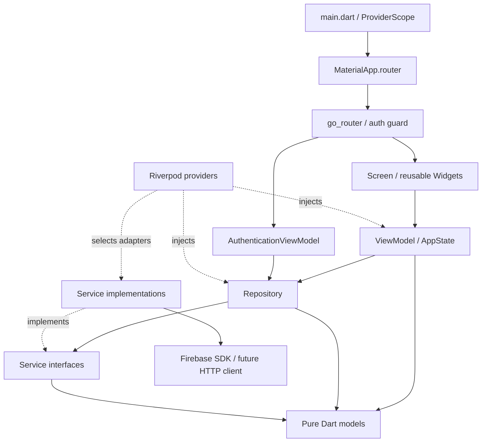

# Kiến trúc source base

Ứng dụng Android `prm393_lab03` dùng MVVM, Riverpod cho state và dependency
injection, go_router cho navigation. Foundation chỉ kiểm tra cấu hình khởi động;
chưa có nghiệp vụ, nguồn dữ liệu sự kiện hay luồng Lab 2.

## Cấu trúc

```text
lib/
├── main.dart                      # Binding + ProviderScope
├── app/
│   ├── app.dart                   # MaterialApp.router
│   ├── router.dart                # Routes, lifecycle, auth refresh
│   └── authentication_guard.dart  # Chính sách guard thuần Dart
├── core/
│   ├── constants/                 # Strings, route names/paths
│   ├── errors/                    # AppException an toàn cho UI
│   ├── providers/                 # Composition root cho services/repositories
│   └── utils/                     # ExceptionMapper
├── theme/                         # AppTheme, màu, typography, layout tokens
├── models/                        # AppState, AuthSession, FirebaseStatus
├── services/                      # Contracts + Firebase SDK boundary
├── repositories/                  # Data access qua service contracts
├── firebase/                      # Cờ cấu hình, không chứa SDK/credentials
├── viewmodels/                    # Presentation state và user actions
├── screens/                       # Render state, chuyển actions cho ViewModel
└── widgets/                       # Button, input, status, responsive layout
test/
├── app/
├── core/
├── helpers/                       # Fakes chỉ dùng trong tests
├── services/
├── viewmodels/
└── widgets/
e2e_test/                          # Chỉ README chuẩn bị ARTEMIS
firebase/
├── storage.rules                  # Deny all; chưa deploy
└── remote-config-defaults.json     # {} chờ xác định keys; chưa tải vào SDK
docs/                             # Architecture + các template kế hoạch
android/                          # Flutter-generated Android host
```

## MVVM và dependency flow



Mũi tên liền mô tả dependency/call direction; state đi ngược về View qua Riverpod.
Models và service contracts không import Flutter, Riverpod hay Firebase SDK.
Repository phụ thuộc service interface; adapter triển khai interface, không để
SDK types như `User`, `FirebaseApp`, `RemoteMessage` lọt ra ViewModel hoặc Widget.
Providers là composition root duy nhất được biết concrete adapters.

- **View:** render `AppLoading`, `AppEmpty`, `AppError`, `AppData`; nút gọi
  `BootstrapViewModel.refresh`. Không gọi service/repository trực tiếp.
- **ViewModel:** điều phối khởi tạo, chặn gọi lặp, đổi lỗi thành AppException,
  kiểm tra lifecycle trước khi cập nhật state. Không import Firebase SDK.
- **Repository:** entry point cho data access. Hiện delegate bootstrap/auth;
  chỉ thêm repositories cho các dịch vụ khác khi có use case thật.
- **Service:** nơi duy nhất được phép gọi Firebase SDK/Google Sign-In/HTTP.
  Hiện chỉ `FirebaseInitializationService` truy cập SDK; sáu dịch vụ còn lại
  chỉ có contracts và adapter pending dùng chung, không gọi mạng.
- **DI:** top-level providers là khai báo bất biến; state do ProviderContainer
  sở hữu, không có global mutable state hoặc singleton trực tiếp trong UI.

## Khởi động và lỗi

`main` → `LabApp` → root screen → `BootstrapViewModel` → `BootstrapRepository`
→ `FirebaseInitializer`.

1. Mặc định `FIREBASE_ENABLED=false`: service trả `notConfigured` trước mọi SDK
   call; ViewModel chuyển sang `AppEmpty` với thông báo rõ ràng.
2. Khi bật cờ sau cấu hình Android thật: service gọi `Firebase.initializeApp()`
   dựa trên native resources do Google Services Gradle plugin tạo.
3. Thành công chỉ có nghĩa Firebase Core đã khởi tạo (`AppData`), chưa có nghĩa
   sáu dịch vụ đã được tích hợp. Adapter pending vẫn giữ nguyên.
4. Khởi tạo lỗi hoặc quá 15 giây: hiển thị `AppError`, cho phép thử lại.
   Raw SDK error không được hiển thị cho người dùng.

Không gắn Crashlytics handlers, Analytics observers, FCM permission prompts,
background messaging handlers hoặc Remote Config fetch trong foundation.
Android manifest tắt auto collection của Analytics, Crashlytics, FCM auto-init.

## Navigation và authentication

Root `/` là route công khai duy nhất. `AuthenticationViewModel` quan sát
`AuthenticationRepository.watchSession`; adapter pending phát trạng thái
`unavailable`, không giả định người dùng đã đăng nhập.

Router giữ nguyên instance khi auth thay đổi và refresh redirect bằng listenable.
Guard từ chối protected routes khi session chưa biết, signed out, unavailable
hoặc stream lỗi; tạm quay về `/`. Danh sách protected paths hiện rỗng. Khi thêm
auth flow, thay fallback bằng route đăng nhập và đăng ký routes được bảo vệ;
quy tắc backend vẫn phải được bảo vệ bằng Firebase Rules, không chỉ UI guard.

## Thay adapter và kiểm thử

Override `firebaseInitializerProvider`, `authenticationServiceProvider` hoặc
provider của từng service bằng fake trong `ProviderScope`/`ProviderContainer`.
Fakes nằm trong `test/helpers`, không đưa vào runtime. SDK adapters mới phải
map exceptions, trả domain models và được inject qua interface hiện có.

Không thêm repository API sự kiện hoặc Firestore trước khi xác nhận nguồn
dữ liệu Lab 2. Không import SDK từ `lib/firebase/`; thư mục đó chỉ chứa thông
tin cấu hình không phụ thuộc SDK. Khi mở rộng ra nền tảng khác Android, đưa
`DefaultFirebaseOptions.currentPlatform` vào **service layer** sau khi CLI sinh
file thật; không đưa SDK initialization vào Widget hoặc ViewModel.
