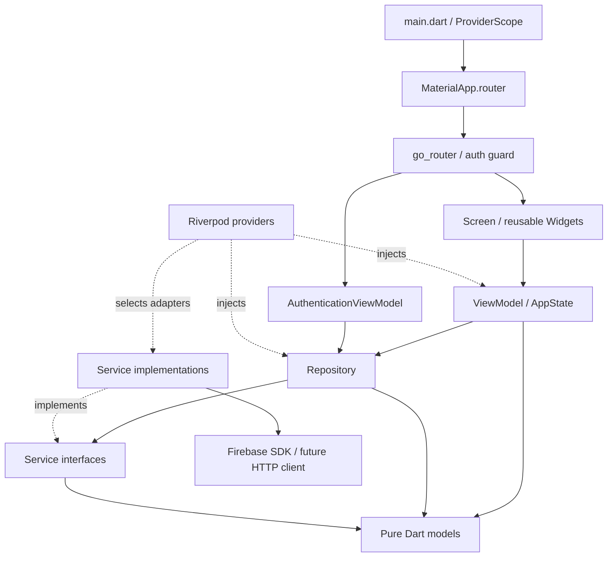

# Kiến trúc source base

Ứng dụng Android `prm393_lab03` dùng MVVM, Riverpod cho state và dependency
injection, go_router cho navigation. Foundation kiểm tra cấu hình khởi động ở
`/foundation`; entry mặc định là S00 `/splash`, S01 Welcome ở `/`, Login ở `/login`.
Bộ 44 màn hình/trạng thái dùng presentation data demo được
người dùng cho phép; chưa có nguồn dữ liệu sự kiện thật hoặc authentication flow.

## Cấu trúc

Android debug build tracking nằm trong `android/app/build.gradle.kts`; chỉ tối ưu
task graph/copy artifacts, không thay MVVM, runtime state hay logic Flutter.
Xem [Build performance](build-performance.md) để biết phạm vi và validation.

```text
lib/
├── main.dart                      # Binding + ProviderScope
├── app/
│   ├── app.dart                   # MaterialApp.router
│   ├── router.dart                # Routes, lifecycle, auth refresh
│   └── authentication_guard.dart  # Chính sách guard thuần Dart
├── core/
│   ├── constants/                 # Strings, route names/paths
│   ├── errors/                    # AppException an toàn cho UI
│   ├── providers/                 # Composition root cho services/repositories
│   └── utils/                     # ExceptionMapper
├── theme/                         # AppTheme, màu, typography, layout tokens
├── models/                        # AppState, AuthSession, FirebaseStatus
├── services/                      # Contracts + Firebase SDK boundary
├── repositories/                  # Data access qua service contracts
├── firebase/                      # Cờ cấu hình, không chứa SDK/credentials
├── viewmodels/                    # Presentation state và user actions
├── screens/                       # Render state, chuyển actions cho ViewModel
└── widgets/                       # Button, input, status, responsive layout
test/
├── app/
├── core/
├── helpers/                       # Fakes chỉ dùng trong tests
├── services/
├── viewmodels/
└── widgets/
e2e_test/                          # Chỉ README chuẩn bị ARTEMIS
firebase/
├── storage.rules                  # Deny all; chưa deploy
└── remote-config-defaults.json     # {} chờ xác định keys; chưa tải vào SDK
docs/                             # Architecture + các template kế hoạch
android/                          # Flutter-generated Android host
```

## MVVM và dependency flow



Mũi tên liền mô tả dependency/call direction; state đi ngược về View qua Riverpod.
Models và service contracts không import Flutter, Riverpod hay Firebase SDK.
Repository phụ thuộc service interface; adapter triển khai interface, không để
SDK types như `User`, `FirebaseApp`, `RemoteMessage` lọt ra ViewModel hoặc Widget.
Providers là composition root duy nhất được biết concrete adapters.

- **View:** render `AppLoading`, `AppEmpty`, `AppError`, `AppData`; nút gọi
  `BootstrapViewModel.refresh`. Không gọi service/repository trực tiếp.
- **ViewModel:** điều phối khởi tạo, chặn gọi lặp, đổi lỗi thành AppException,
  kiểm tra lifecycle trước khi cập nhật state. Không import Firebase SDK.
- **Repository:** entry point cho data access. Hiện delegate bootstrap/auth;
  chỉ thêm repositories cho các dịch vụ khác khi có use case thật.
- **Service:** nơi duy nhất được phép gọi Firebase SDK/Google Sign-In/HTTP.
  Hiện chỉ `FirebaseInitializationService` truy cập SDK; sáu dịch vụ còn lại
  chỉ có contracts và adapter pending dùng chung, không gọi mạng.
- **DI:** top-level providers là khai báo bất biến; state do ProviderContainer
  sở hữu, không có global mutable state hoặc singleton trực tiếp trong UI.

## Khởi động và lỗi

S00 dùng `startupDestinationProvider` để kết hợp `BootstrapViewModel`,
`AuthenticationViewModel` và trạng thái personalization theo user trong
`EviaViewModel`. View chỉ điều phối animation/ảnh sẵn sàng và điều hướng một lần;
không tự gọi service, không dùng timer đơn độc để quyết định route.
`EviaSplashLogo` chỉ quản lý presentation: ba lớp ảnh dùng chung tọa độ alpha,
ticket translateX từ tâm viewport về vị trí cuối, wordmark clip trái→phải, rays
pulse một lần. Chờ các ảnh cần dùng decode rồi mới chạy controller. Reduced
motion dùng nguyên PNG đầy đủ tĩnh. Không thay đổi startup provider/auth flow
khi thay implementation animation.
Bootstrap loading hoặc auth chưa xác định giữ logo; bootstrap lỗi đến foundation.
Auth unavailable/signed out/lỗi đến Welcome. Signed in đến Interests hoặc Discover
theo `AuthSession.personalizationHandled` và thao tác Continue/Skip trong phiên.
Không dùng các interests demo làm bằng chứng đã hoàn tất onboarding.

Chưa có account-profile adapter/persistence: field personalization phải được
adapter thật cung cấp khi tích hợp. Trạng thái hoàn tất trong phiên được tách
theo user ID, không đổi session và không xóa sở thích. Không ghi nhận đây là
đồng bộ backend. Các deep link UI hiện có vẫn giữ nguyên.

Khi mở `/foundation`: `main` → `LabApp` → foundation screen → `BootstrapViewModel` → `BootstrapRepository`
→ `FirebaseInitializer`.

1. Mặc định `FIREBASE_ENABLED=false`: service trả `notConfigured` trước mọi SDK
   call; ViewModel chuyển sang `AppEmpty` với thông báo rõ ràng.
2. Khi bật cờ sau cấu hình Android thật: service gọi `Firebase.initializeApp()`
   dựa trên native resources do Google Services Gradle plugin tạo.
3. Thành công chỉ có nghĩa Firebase Core đã khởi tạo (`AppData`), chưa có nghĩa
   sáu dịch vụ đã được tích hợp. Adapter pending vẫn giữ nguyên.
4. Khởi tạo lỗi hoặc quá 15 giây: hiển thị `AppError`, cho phép thử lại.
   Raw SDK error không được hiển thị cho người dùng.

Không gắn Crashlytics handlers, Analytics observers, FCM permission prompts,
background messaging handlers hoặc Remote Config fetch trong foundation.
Android manifest tắt auto collection của Analytics, Crashlytics, FCM auto-init.

## Navigation và authentication

Các route entry, nội dung sự kiện công khai và `/foundation` không cần đăng nhập.
Các route cá nhân/thao tác tài khoản áp dụng guard S01 bên dưới. `AuthenticationViewModel` quan sát
`AuthenticationRepository.watchSession`; adapter pending phát trạng thái
`unavailable`, không giả định người dùng đã đăng nhập.

Router giữ nguyên instance khi auth thay đổi và refresh redirect bằng listenable.
Guard từ chối protected routes khi session chưa biết, signed out, unavailable
hoặc stream lỗi; đến `/login` với query `from` giữ deep link nội bộ an toàn.
Các nhóm `/registration`, `/my-events`, `/profile`, `/following` và voucher/
locker/confirm/success được bảo vệ. Organizer/event details/search vẫn công khai.
`ensureAuthenticated` chuyển action công khai cần tài khoản đến Login; các
ViewModel cũng kiểm tra `hasAuthenticatedSessionProvider` trước khi mutate.
Không dùng việc UI hiển thị fixtures làm bằng chứng session đã đăng nhập.
Backend vẫn phải bảo vệ bằng authorization/Firebase Rules, không chỉ UI guard.

S01 dùng `WelcomeTokens` cục bộ và AppButton, PNG logo/hero riêng, SafeArea và
scroll. Màn đăng nhập cũ chuyển sang `/login`; `/signup` là form Create Account,
adapter tạo tài khoản vẫn pending. Không phát sinh tài khoản hoặc response giả. Khi session thật
đăng nhập trên các entry screens, router bỏ qua Welcome và dùng trạng thái
personalization hiện có để đến Interests/Discover. S00 animation không thay đổi.

Sign Up: View giữ controllers/focus/keyboard layout; `SignUpViewModel` auto-dispose
quản lý validation, trạng thái loading, chống gửi lặp, lỗi inline và checkbox.
Không lưu password trong presentation state hoặc logs. Data access đi qua
AuthenticationRepository → AuthenticationService.createAccount/signInWithGoogle.
Service trả AccountCreationResult (signedIn/verificationRequired), không có SDK types.
minimumPasswordLength nullable thuộc adapter; null là chưa biết policy, không phải 0.
Pending adapter ném AppException và không trả tài khoản giả. Email conflicts/weak
password được map thành lỗi field an toàn. Khi verificationRequired, giữ form và
hướng dẫn xác minh rồi Log In; adapter không được phát session dùng được trước đó.
Khi signedIn, VM chờ session stream; router hiện có quyết định Interests/Discover.
Google tái sử dụng contract có sẵn, không tự tạo/link tài khoản bằng email phía UI.
Terms/Privacy chưa có destination nên không có link/trang pháp lý giả.
Sign Up dùng logo/tagline như Login, không collage; consent sau fields, Google sau Create Account.
Feedback gửi form được cuộn vào vùng nhìn thấy khi cần. Login giữ nguyên layout.

Welcome → Login dùng CustomTransitionPage với slide nhẹ từ phải + fade, 280ms;
pop chạy ngược 220ms, giữ Welcome trong back stack. Tokens nằm ở `AppMotion`.
Reduced motion đặt cả hai duration về zero. Không thay bố cục Login hoặc auth flow.

Login giữ bố cục đầy đủ khi bàn phím ảo đóng. Khi `viewInsets.bottom > 0`, chỉ
header chuyển sang dạng gọn: ẩn collage/tagline/Skip, logo thu nhỏ,
form đi lên trong 180ms. Focus không tự kích hoạt dạng gọn (hỗ trợ bàn phím cứng).
Các field/controllers/focus nodes giữ nguyên; chuyển Email → Password không tạo
lại form. Sau reflow chỉ cuộn nếu ô đang nhập bị che; đóng bàn phím không ép cuộn
về đầu. Đây là presentation state trong View, không thay auth/business rules.

## Evia presentation flow

`lib/screens/evia/` render state từ `EviaViewModel` và chuyển các actions tìm kiếm,
lọc, chọn sở thích, bookmark, follow cho ViewModel. Models ở `evia_models.dart`
không phụ thuộc Flutter. `lib/data/mock/evia_mock_data.dart` là ngoại lệ dữ liệu
mẫu đã được người dùng cho phép riêng cho task clone Figma; không phải adapter
dịch vụ hoặc bằng chứng backend đã hoạt động. Không thêm repository/service
không cần thiết để bọc dữ liệu presentation tĩnh.

`EviaViewModel` được sở hữu bởi ProviderContainer và giữ state trong phiên app.
Draft filters chỉ áp dụng sau **Apply Filters**; đóng màn hình không sửa filters
đang dùng. Follow/bookmark dùng chung state giữa các màn hình. Các URL demo trực
tiếp không thay đổi `AuthSession`, không vượt qua guard cho protected routes.

`FigmaAssets` ánh xạ exports cục bộ, `EviaTheme` bổ sung tokens, `evia_widgets.dart`
và `evia_brand.dart` chứa các thành phần giao diện dùng lại. Không thêm tải font
runtime, tracking hoặc Firebase SDK calls trong View/ViewModel.

## Thay adapter và kiểm thử

### My Events / Rewards presentation

`ActivityViewModel` manages presentation filters, calendar selections, demo
cancellations, reward search and voucher selection. Coin balances, transactions,
verified events and receipts are static preview fixtures in `ActivityMockData`.

Check-in and redemption report unavailable without mutating financial state.
Registration requiring a deposit also waits for the coin API. Local currency
persistence and streak calculations are removed. Daily Check-in displays a day-8
fixture and the proposed reward schedule only; it does not confirm real rewards.

Rewards share one provider and wallet widget. Locker opens the matching sample
voucher, rejects unknown codes and returns to catalog on Back. Future API work
must follow View -> ViewModel -> Repository -> Service interface -> SDK adapter;
the backend owns balances, streaks, transactions and voucher issuance.

`ActivityAssets`, `ActivityIcon` và `RewardsWallet` dùng exports theo từng Figma
node. `ActivityTheme` chứa measurements/colors bổ sung. Font button ghi rõ Roboto
fallback để widget render dùng cùng family với app thay vì fallback khác.

`CoinIcon` là widget dùng chung cho các biểu tượng xu: một SVG đã bundle, có size
và tint theo ngữ cảnh. Screens dùng widget này thay vì chọn riêng asset xu hoặc
ghép các vector/ký tự, giữ cách biểu diễn tiền xu nhất quán.

Override `firebaseInitializerProvider`, `authenticationServiceProvider` hoặc
provider của từng service bằng fake trong `ProviderScope`/`ProviderContainer`.
Fakes nằm trong `test/helpers`, không đưa vào runtime. SDK adapters mới phải
map exceptions, trả domain models và được inject qua interface hiện có.

Không thêm repository API sự kiện hoặc Firestore trước khi xác nhận nguồn
dữ liệu Lab 2. Không import SDK từ `lib/firebase/`; thư mục đó chỉ chứa thông
tin cấu hình không phụ thuộc SDK. Khi mở rộng ra nền tảng khác Android, đưa
`DefaultFirebaseOptions.currentPlatform` vào **service layer** sau khi CLI sinh
file thật; không đưa SDK initialization vào Widget hoặc ViewModel.

## Event registration / Profile presentation

`RegistrationViewModel` giữ identity fields, consent, field errors, event ID,
loading và outcome. Preset chỉ thiết lập reference state. Submit có delay inject
được, validate trước khi xử lý, chặn duplicate pending và bỏ kết quả sau dispose
hoặc invalidation. Thành công chuyển registration cho ActivityViewModel; activity
cập nhật available/deposits/registrations cùng một state assignment. Failed/full
không đổi ví. Không thêm service giả hoặc Firebase adapter.

`ProfileViewModel` giữ saved IDs, filter, read-notification IDs, draft interests,
profile fields và organizer presentation state. Save interests dùng chung
EviaViewModel nên cập nhật feed; follow dùng cùng organizer ID `union`.
Forms và result screens dùng shared AppButton/AppTextField, ActivityIcon và
FlowEventSummary. FlowAssets chứa 180 exports; ActivityAssets compose map này.
Models trong registration_models.dart vẫn thuần Dart. Static map là SVG native;
ảnh crowd ở hai error frames được crop đúng từ source snapshot do Figma cung cấp.
Các controls chuyển actions cho VM; không gọi HTTP, auth, camera hoặc SDK.
