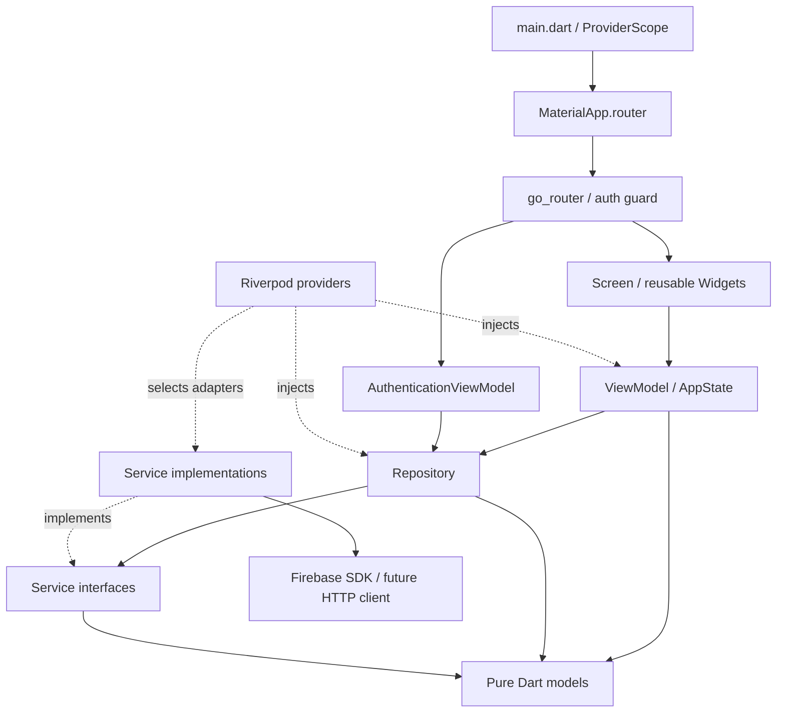

# Kiến trúc source base

> **Project hiện tại:** `prm393-31822` (evia, Blaze), theo yêu cầu chuyển của người dùng.
> App đã chuyển bằng FlutterFire; 32 Functions + Rules đã deploy, 14 indexes READY.
> API smoke cloud + 20 Emulator tests + APK/startup Core đạt; [evidence](firebase-migration.md).
> UI, Google login/push thật và dữ liệu catalog chưa tích hợp.
> Các mục về `evia-lab3-kiet-2026` bên dưới là lịch sử, không phải project để deploy tiếp.


## Backend nghiệp vụ độc lập — 04/11/2026

`functions/src/index.ts` nhận HTTPS Callable với Firebase Auth context →
`backend.ts` validate/dispatch → accounts/events/rewards/queries → Admin SDK
Firestore transactions. Monetary writes dùng receipt + ledger atomic; callable
không tin UID/role/giá trị tiền từ client. Rules từ chối mọi client mutation.
`catalog.ts` + create-only importer quản lý dữ liệu được duyệt, không seed giả.

Flutter vẫn giữ View → ViewModel → Repository → Service interface → SDK adapter.
Task này **không sửa Dart/UI**, không thay pending providers hoặc giả rằng UI đã
đăng nhập/gọi backend. Khi frontend sẵn sàng, thêm service adapter dùng callable
region asia-southeast1 và domain models theo [API v1](backend-integration.md),
đồng thời test state/error/auth guard. Auth credentials thuộc Firebase Auth SDK.

`firebase.json` cấu hình Auth/Firestore/Functions/Storage Emulators; tests chỉ
project demo loopback. Rules/indexes đã deploy lên project nhóm; Functions theo trạng thái migration. FCM trigger
chuẩn bị gửi inbox notifications thật, bỏ qua rõ ràng trên Emulator. Analytics,
Crashlytics, Remote Config app-side không đổi.

Thư mục thêm: `functions/src/`, `functions/test/`, `functions/scripts/`,
`evidence/backend/`. Xem `functions/README.md` để chạy không cần UI.


## Cập nhật Firebase development 04/11/2026

Android đã được FlutterFire cấu hình cho `evia-lab3-kiet-2026`; xem
[firebase-setup.md](firebase-setup.md). Firestore cloud đã tạo với Rules deny-all,
chưa có adapter/data model nghiệp vụ trong app. Dependency flow và sáu
`PendingFirebaseServices` giữ nguyên; Firebase Core ready chỉ xác nhận bootstrap.
`FIREBASE_ENABLED` tiếp tục mặc định false, có thể mở `/foundation` để kiểm tra.

Ứng dụng Android `prm393_lab03` dùng MVVM, Riverpod cho state và dependency
injection, go_router cho navigation. Foundation kiểm tra cấu hình khởi động ở
`/foundation`; root là Evia login. Bộ 44 màn hình/trạng thái dùng presentation data demo được
người dùng cho phép; chưa có nguồn dữ liệu sự kiện thật hoặc authentication flow.

## Cấu trúc

```text
lib/
├── main.dart                      # Binding + ProviderScope
├── app/
│   ├── app.dart                   # MaterialApp.router
│   ├── router.dart                # Routes, lifecycle, auth refresh
│   └── authentication_guard.dart  # Chính sách guard thuần Dart
├── core/
│   ├── constants/                 # Strings, route names/paths
│   ├── errors/                    # AppException an toàn cho UI
│   ├── providers/                 # Composition root cho services/repositories
│   └── utils/                     # ExceptionMapper
├── theme/                         # AppTheme, màu, typography, layout tokens
├── models/                        # AppState, AuthSession, FirebaseStatus
├── services/                      # Contracts + Firebase SDK boundary
├── repositories/                  # Data access qua service contracts
├── firebase/                      # Cờ cấu hình, không chứa SDK/credentials
├── viewmodels/                    # Presentation state và user actions
├── screens/                       # Render state, chuyển actions cho ViewModel
└── widgets/                       # Button, input, status, responsive layout
test/
├── app/
├── core/
├── helpers/                       # Fakes chỉ dùng trong tests
├── services/
├── viewmodels/
└── widgets/
e2e_test/                          # Chỉ README chuẩn bị ARTEMIS
firebase/
├── storage.rules                  # Own create-only PDF reports; local only
└── remote-config-defaults.json     # {} chờ xác định keys; chưa tải vào SDK
docs/                             # Architecture + các template kế hoạch
android/                          # Flutter-generated Android host
```

## MVVM và dependency flow



Mũi tên liền mô tả dependency/call direction; state đi ngược về View qua Riverpod.
Models và service contracts không import Flutter, Riverpod hay Firebase SDK.
Repository phụ thuộc service interface; adapter triển khai interface, không để
SDK types như `User`, `FirebaseApp`, `RemoteMessage` lọt ra ViewModel hoặc Widget.
Providers là composition root duy nhất được biết concrete adapters.

- **View:** render `AppLoading`, `AppEmpty`, `AppError`, `AppData`; nút gọi
  `BootstrapViewModel.refresh`. Không gọi service/repository trực tiếp.
- **ViewModel:** điều phối khởi tạo, chặn gọi lặp, đổi lỗi thành AppException,
  kiểm tra lifecycle trước khi cập nhật state. Không import Firebase SDK.
- **Repository:** entry point cho data access. Hiện delegate bootstrap/auth;
  chỉ thêm repositories cho các dịch vụ khác khi có use case thật.
- **Service:** nơi duy nhất được phép gọi Firebase SDK/Google Sign-In/HTTP.
  Hiện chỉ `FirebaseInitializationService` truy cập SDK; sáu dịch vụ còn lại
  chỉ có contracts và adapter pending dùng chung, không gọi mạng.
- **DI:** top-level providers là khai báo bất biến; state do ProviderContainer
  sở hữu, không có global mutable state hoặc singleton trực tiếp trong UI.

## Khởi động và lỗi

Khi mở `/foundation`: `main` → `LabApp` → foundation screen → `BootstrapViewModel` → `BootstrapRepository`
→ `FirebaseInitializer`.

1. Mặc định `FIREBASE_ENABLED=false`: service trả `notConfigured` trước mọi SDK
   call; ViewModel chuyển sang `AppEmpty` với thông báo rõ ràng.
2. Khi bật cờ sau cấu hình Android thật: service gọi `Firebase.initializeApp()`
   dựa trên native resources do Google Services Gradle plugin tạo.
3. Thành công chỉ có nghĩa Firebase Core đã khởi tạo (`AppData`), chưa có nghĩa
   sáu dịch vụ đã được tích hợp. Adapter pending vẫn giữ nguyên.
4. Khởi tạo lỗi hoặc quá 15 giây: hiển thị `AppError`, cho phép thử lại.
   Raw SDK error không được hiển thị cho người dùng.

Không gắn Crashlytics handlers, Analytics observers, FCM permission prompts,
background messaging handlers hoặc Remote Config fetch trong foundation.
Android manifest tắt auto collection của Analytics, Crashlytics, FCM auto-init.

## Navigation và authentication

Các route UI demo Evia và `/foundation` là công khai. `AuthenticationViewModel` quan sát
`AuthenticationRepository.watchSession`; adapter pending phát trạng thái
`unavailable`, không giả định người dùng đã đăng nhập.

Router giữ nguyên instance khi auth thay đổi và refresh redirect bằng listenable.
Guard từ chối protected routes khi session chưa biết, signed out, unavailable
hoặc stream lỗi; tạm quay về `/`. Danh sách protected paths hiện rỗng. Khi thêm
auth flow, thay fallback bằng route đăng nhập và đăng ký routes được bảo vệ;
quy tắc backend vẫn phải được bảo vệ bằng Firebase Rules, không chỉ UI guard.

## Evia presentation flow

`lib/screens/evia/` render state từ `EviaViewModel` và chuyển các actions tìm kiếm,
lọc, chọn sở thích, bookmark, follow cho ViewModel. Models ở `evia_models.dart`
không phụ thuộc Flutter. `lib/data/mock/evia_mock_data.dart` là ngoại lệ dữ liệu
mẫu đã được người dùng cho phép riêng cho task clone Figma; không phải adapter
dịch vụ hoặc bằng chứng backend đã hoạt động. Không thêm repository/service
không cần thiết để bọc dữ liệu presentation tĩnh.

`EviaViewModel` được sở hữu bởi ProviderContainer và giữ state trong phiên app.
Draft filters chỉ áp dụng sau **Apply Filters**; đóng màn hình không sửa filters
đang dùng. Follow/bookmark dùng chung state giữa các màn hình. Các URL demo trực
tiếp không thay đổi `AuthSession`, không vượt qua guard cho protected routes.

`FigmaAssets` ánh xạ exports cục bộ, `EviaTheme` bổ sung tokens, `evia_widgets.dart`
và `evia_brand.dart` chứa các thành phần giao diện dùng lại. Không thêm tải font
runtime, tracking hoặc Firebase SDK calls trong View/ViewModel.

## Thay adapter và kiểm thử

### My Events / Rewards presentation

`ActivityViewModel` quản lý tab, ngày/tuần/lịch tháng, draft ngày, cancelled IDs,
available/deposit balances, daily check-in, verified event IDs, redemption receipt,
reward search/category và transaction filters. Models nằm trong
`activity_models.dart`, fixtures trong `data/mock/activity_mock_data.dart`.
User đã cho phép tiếp tục dùng mock data tách riêng; không thêm service giả trả
thành công, Firebase calls hoặc quyền camera.

`MyEventsScreen` render các preset Figma và chuyển date/cancel actions cho VM.
`MonthlyCalendar` giữ lựa chọn draft qua VM đến **Apply date**. Ticket chặn hiển
thị QR nếu registration đã hủy. Check-in preview chỉ xác nhận mã fixture; VM
chặn credit lặp bằng verified IDs. Daily reward và redemption được chặn lặp
bằng state, số xu/deposit và receipt cập nhật trong cùng một state assignment.

`RewardsScreen`, details/confirmation, locker/voucher/success, milestones/history
cùng quan sát một provider nên phản ánh cùng ví xu. Clipboard copy là platform UI
action trong widget; không gọi SDK hay HTTP. Available/deposits được tách biệt.
Các route reference công khai phục vụ UI demo, không cấp quyền backend.

`ActivityAssets`, `ActivityIcon` và `RewardsWallet` dùng exports theo từng Figma
node. `ActivityTheme` chứa measurements/colors bổ sung. Font button ghi rõ Roboto
fallback để widget render dùng cùng family với app thay vì fallback khác.

Override `firebaseInitializerProvider`, `authenticationServiceProvider` hoặc
provider của từng service bằng fake trong `ProviderScope`/`ProviderContainer`.
Fakes nằm trong `test/helpers`, không đưa vào runtime. SDK adapters mới phải
map exceptions, trả domain models và được inject qua interface hiện có.

Không thêm repository API sự kiện hoặc Firestore trước khi xác nhận nguồn
dữ liệu Lab 2. Không import SDK từ `lib/firebase/`; thư mục đó chỉ chứa thông
tin cấu hình không phụ thuộc SDK. Khi mở rộng ra nền tảng khác Android, đưa
`DefaultFirebaseOptions.currentPlatform` vào **service layer** sau khi CLI sinh
file thật; không đưa SDK initialization vào Widget hoặc ViewModel.

## Event registration / Profile presentation

`RegistrationViewModel` giữ identity fields, consent, field errors, event ID,
loading và outcome. Preset chỉ thiết lập reference state. Submit có delay inject
được, validate trước khi xử lý, chặn duplicate pending và bỏ kết quả sau dispose
hoặc invalidation. Thành công chuyển registration cho ActivityViewModel; activity
cập nhật available/deposits/registrations cùng một state assignment. Failed/full
không đổi ví. Không thêm service giả hoặc Firebase adapter.

`ProfileViewModel` giữ saved IDs, filter, read-notification IDs, draft interests,
profile fields và organizer presentation state. Save interests dùng chung
EviaViewModel nên cập nhật feed; follow dùng cùng organizer ID `union`.
Forms và result screens dùng shared AppButton/AppTextField, ActivityIcon và
FlowEventSummary. FlowAssets chứa 180 exports; ActivityAssets compose map này.
Models trong registration_models.dart vẫn thuần Dart. Static map là SVG native;
ảnh crowd ở hai error frames được crop đúng từ source snapshot do Figma cung cấp.
Các controls chuyển actions cho VM; không gọi HTTP, auth, camera hoặc SDK.
