# Báo cáo Kiểm thử E2E ARTEMIS — EVIA (`TC01`–`TC19`)

> **Flutter regression cập nhật 12/11/2026:** đã xử lý bốn test thất bại ở
> mục 7.2. Bốn file widget test đạt **47/47**, toàn bộ Flutter suite đạt
> **264/264**, analyzer sạch. Chi tiết sửa UI/retry và cách test spinner tại
> [test plan](../docs/test-plan.md#khắc-phục-bốn-flutter-regression--12112026).
> Kết quả `260 passed, 4 failed` ở mục 7.2 được giữ để đối chiếu trước sửa.

> [!IMPORTANT]
> **Trạng thái sửa lỗi: ĐÃ SỬA, DEPLOY VÀ XÁC MINH ĐẠT `TC15`, `TC03`, `TC19` VÀ `TC11` (`19/19` TCs PASSED HOÀN TOÀN; `0` FAILED).**
> Đợt kiểm thử nền tảng ngày `2026-11-11` chạy 19 test cases (21 biến thể) trên bản build thật (`FIREBASE_ENABLED=true`). Ngày `2026-11-12`, toàn bộ các tồn đọng đã được khắc phục, triển khai và tái kiểm chứng PASSED end-to-end trên thiết bị thật (`SM-A135F`) qua Google ARTEMIS + `adb logcat -s FA-SVC` và Admin Web live (`https://admin-evia.vercel.app/`): **`TC15`** ([Mục 6](#6-bằng-chứng-khắc-phục-và-tái-kiểm-chứng-lỗi-tc15)), **`TC03`**, **`TC19`** và **`TC11`** ([Mục 7](#7-bằng-chứng-khắc-phục-tc03-tc19-và-hoàn-tất-tc11)) sau khi đăng nhập Firebase CLI và deploy `verifyAdminTicketNumber(asia-southeast1)` lên project `prm393-31822`.

---

## 1. Thông tin phiên kiểm thử

- **Ngày thực hiện:** `2026-11-11` (`14:23:29` → `18:10:04` `+07:00`)
- **Ứng dụng mục tiêu:** EVIA (`com.example.prm393_lab03`, `versionName=0.1.0`, `FIREBASE_ENABLED=true`)
- **Thiết bị vật lý:** Samsung Galaxy A13 (`SM-A135F`, Serial `R58T80PE55F`, Android 14, không lắp SIM — dùng Wi-Fi)
- **Tài khoản kiểm thử Android:** `phuc250805@gmail.com` (`Phuc Tran Dinh`)
- **Admin Web đối ứng:** `https://admin-evia.vercel.app/` (kiểm thử chéo qua Chrome MCP)
- **Công cụ điều phối:** Google ARTEMIS (`Flash` mặc định cho 18 TCs + re-test `TC15`; `Pro` cho `TC19` + `Flash` xác minh bổ sung)
- **Thư mục ảnh chứng cứ:**
  - Phiên đầy đủ ngày `2026-11-11`: [`evidence-2026-11-11/`](evidence-2026-11-11/) (`40` ảnh đã đối chiếu trực quan theo từng bước trace)
  - Đợt sửa & tái kiểm chứng `TC15` ngày `2026-11-12`: [`evidence-2026-11-12-tc15/`](evidence-2026-11-12-tc15/) (`3` ảnh xác minh trực quan theo Trace `89501bda`)
  - Đợt sửa & tái kiểm chứng `TC03`, `TC19` và deploy + re-test `TC11` ngày `2026-11-12`: [`evidence-2026-11-12-fixes/`](evidence-2026-11-12-fixes/) (`7` ảnh xác minh trực quan từ các Traces `dfb740a1`, `1f7cb4e5`, `b06ee08f`, `fcb9f81d` và phiên Chrome `#check-in`)
- **Phạm vi báo cáo:** Tổng hợp **phiên hồi quy đầy đủ ngày `2026-11-11`** (`19/19` TCs với `FIREBASE_ENABLED=true`), **đợt sửa & tái kiểm chứng `TC15`** và **đợt sửa `TC03`, `TC19` + deploy & tái kiểm chứng `TC11` ngày `2026-11-12`**.

---

## 2. Thời gian chạy kiểm thử (`Test Duration`)

| Chỉ số thời gian | Giá trị quan sát thực tế | Ghi chú / Phạm vi tính |
| --- | --- | --- |
| **Tổng thời gian phiên làm việc nền `2026-11-11` (Wall-clock)** | **`3 giờ 46 phút 35 giây`** | Từ trace đầu tiên `14:23:29` (`f8832ee0`) đến trace cuối `18:10:04` (`94e8d1c9`) ngày `2026-11-11`. |
| **Khoảng tạm dừng đổi model / chờ quota (`2026-11-11`)** | **`79 phút 29 giây`** | Từ `15:03:53` (lỗi quota ở `065b49ce` — `TC08`) đến `16:23:22` (`e4dddd4c`). |
| **Thời gian vận hành liên tục thực tế `2026-11-11`** | **`~2 giờ 27 phút`** | Bao gồm toàn bộ thời gian ARTEMIS chạy trên thiết bị, thao tác chuẩn bị/xác minh trên Admin Web (`#events`, `#checkin`, `#config`), `adb` và kiểm tra log. |
| **Tổng thời gian ARTEMIS chạy thực tế ngày `2026-11-11` (toàn bộ `41` traces)** | **`4,665.1 giây` (`77 phút 45.1 giây`)** | Cộng dồn `end_time - start_time` trong `status.json` của cả `41` traces ngày `2026-11-11`. |
| **Tổng thời gian ARTEMIS của riêng các traces hiệu lực `2026-11-11` (`TC01`–`TC19`)** | **`3,374.2 giây` (`56 phút 14.2 giây`)** | Tính tổng `24` traces hiệu lực ngày `2026-11-11` (kể cả `23bbc0ca` chuẩn bị trạng thái *I'm Going* cho `TC17`), loại trừ `2` pre-check ban đầu và các lần retry/cancelled trước đó. |
| **Thời gian chạy lại `TC15` sau sửa (`2026-11-12`, Trace `89501bda`)** | **`88.6 giây` (`1 phút 28.6 giây`)** | Từ `11:27:37` đến `11:29:06` ngày `2026-11-12` trên thiết bị `SM-A135F` (`R58T80PE55F`), model `Flash`, trạng thái `completed`. |
| **Thời gian chạy lại `TC03` sau sửa (`2026-11-12`, Trace `88a878c4`)** | **`95.3 giây` (`1 phút 35.3 giây`)** | Đợt `2026-11-12` trên bản APK bật cả `FIREBASE_ENABLED=true` và `ANALYTICS_ENABLED=true`, model `Flash`, `completed`. |
| **Thời gian chạy lại `TC19` Phase 1 — Offline Error (`2026-11-12`, Trace `dfb740a1`)** | **`49.0 giây`** | Tắt Wi-Fi qua `svc wifi disable`, tìm `"Flutter"`, kiểm tra ẩn `EviaSkeleton` và hiện ngay nút `'Thử lại'`, model `Flash`, `completed`. |
| **Thời gian chạy lại `TC19` Phase 2 — Recovery (`2026-11-12`, Trace `1f7cb4e5`)** | **`48.3 giây`** | Bật lại Wi-Fi (`svc wifi enable`), chạm trực tiếp nút `'Thử lại'` từ màn lỗi, phục hồi `"2 events found"`, model `Flash`, `completed`. |
| **Thời gian tái kiểm chứng `TC11` End-to-End sau deploy (`2026-11-12`, Traces `b06ee08f` + `fcb9f81d`)** | **`225.8 giây`** | `b06ee08f` (`195.0s`, đăng ký `[QA] Kiểm thử Check-in Admin 12/11` -> vé `EV-EA2798C01639`, số dư `30 coins`) + Admin Web `verifyAdminTicketNumber` HTTP `200`/`409` + `fcb9f81d` (`30.8s`, xác nhận `Attended` & ví tăng `35 coins`), model `Flash`, `completed`. |

---

## 3. Tổng kết Pass / Failed (`19` Test Cases / `21` biến thể)

> Lưu ý cách đếm: Bộ test [`e2e_test/cases.py`](../e2e_test/cases.py) có **19 Test Cases (`TC01`–`TC19`)**, riêng **`TC17`** kiểm thử trên **3 trạng thái vòng đời push (`foreground`, `background`, `terminated`)**, nâng tổng số biến thể thực thi lên **21 biến thể**.

| Nhóm kết quả | Số Test Case (`19` TCs) | Số biến thể (`21` biến thể) | Danh sách cụ thể |
| --- | --- | --- | --- |
| **PASSED hoàn toàn** | **19** *(trước các đợt sửa `2026-11-12`: 15)* | **21** *(trước sửa: 17)* | `TC01`, `TC02`, **`TC03` (Đã sửa & Re-test `2026-11-12`)**, `TC04`, `TC05`, `TC06`, `TC07`, `TC08`, `TC09`, `TC10`, **`TC11` (Đã deploy & Re-test `2026-11-12`)**, `TC12`, `TC13`, `TC14`, **`TC15` (Đã sửa & Re-test `2026-11-12`)**, `TC16`, `TC17` (`foreground`, `background`, `terminated`), `TC18`, **`TC19` (Đã sửa & Re-test `2026-11-12`)** |
| **CHỜ DEPLOY Admin Web** | **0** *(đã hoàn tất deploy `TC11`)* | **0** | *(Đã deploy `functions:evia:verifyAdminTicketNumber` lên `prm393-31822` và xác minh HTTP `404 TICKET_NUMBER_NOT_FOUND` / `200` / `409 ALREADY_CHECKED_IN`)* |
| **FAILED** | **0** *(trước sửa `TC15`: 1)* | **0** *(trước sửa: 1)* | *(Không còn TC FAILED; toàn bộ tồn đọng trong phạm vi app/backend đã sửa, deploy và verified — xem [Mục 6](#6-bằng-chứng-khắc-phục-và-tái-kiểm-chứng-lỗi-tc15) và [Mục 7](#7-bằng-chứng-khắc-phục-tc03-tc19-và-hoàn-tất-tc11))* |
| **Tổng cộng** | **19** | **21** | **19 / 19 TCs PASSED hoàn toàn (21/21 biến thể); 0 / 19 TC FAILED** |

---

## 4. Tổng hợp lỗi và trạng thái xử lý

**Toàn bộ 4/4 vấn đề app/backend đã được khắc phục, triển khai và tái kiểm chứng PASSED ngày `2026-11-12`: `TC15` ([Mục 4.1](#41-tc15-đã-sửa-và-passed--lưu-csv-cục-bộ-và-tải-báo-cáo-pdf-lên-firebase-cloud-storage)), `TC11` ([Mục 4.2](#42-tc11-đã-deploy-và-passed--nhập-tay-ticket-number-trên-admin-web-và-cộng-xu-end-to-end)), `TC03` ([Mục 4.3](#43-tc03-đã-sửa-và-passed--search--explore-bắn-sự-kiện-firebase-analytics-search)) và `TC19` ([Mục 4.4](#44-tc19-đã-sửa-và-passed--hết-chồng-eviaskeleton-trên-apperrorwidget-và-khôi-phục-nút-thử-lại)).**

### 4.1. TC15 ĐÃ SỬA VÀ PASSED — Lưu CSV cục bộ và tải báo cáo PDF lên Firebase Cloud Storage

- **Hiện tượng ban đầu (`2026-11-11`, Trace `50d8a6b7`, `FAILED`):**
  - Nút xuất CSV trên `Coin History` tạo file local thành công qua Android Storage Access Framework (`/sdcard/Download/evia-coin-history.csv`, dung lượng `388` bytes, UTF-8 BOM `\ufeffdate,kind,coins`, 10 giao dịch), UI báo `"Đã lưu báo cáo CSV (10 giao dịch đã tải)."`.
  - Tuy nhiên **chưa có thao tác upload nào lên Firebase Cloud Storage (`reports/{uid}/...`)**.
- **Nguyên nhân gốc rễ đã kiểm chứng trong code trước khi sửa:**
  1. Tại [`lib/core/providers/service_providers.dart`](../lib/core/providers/service_providers.dart), `storageServiceProvider` ban đầu trỏ cố định vào `_pendingServicesProvider` ([`PendingFirebaseServices`](../lib/services/pending_firebase_services.dart), trả lỗi `firebase_service_pending`).
  2. [`ReportExportRepository`](../lib/repositories/report_export_repository.dart) và [`ReportExportViewModel`](../lib/viewmodels/report_export_view_model.dart) trước đây chỉ gọi `ReportExportService.saveCsv(bytes)` rồi ghi analytics `'generate_report'`, chưa gọi hợp đồng [`StorageService.upload(...)`](../lib/services/storage_service.dart).
  3. Tại [`firebase/storage.rules`](../firebase/storage.rules#L18-L27), nhánh `/reports/{uid}/{fileName}` chỉ cho phép `allow create` khi `resource == null`, `contentType == 'application/pdf'` và tên file khớp `[A-Za-z0-9_-]+[.]pdf` (tối đa 5 MiB).
- **Trạng thái:** **ĐÃ SỬA VÀ TÁI KIỂM CHỨNG PASSED (`2026-11-12`, Trace `89501bda`, `88.6s`).**
- **Tóm tắt phương án đã triển khai (Phương án A — giữ CSV cục bộ + bổ sung PDF Cloud Storage khớp 100% `storage.rules`):**
  1. Bổ sung [`FirebaseStorageService`](../lib/services/firebase_storage_service.dart) (`firebase_storage: ^14.0.1`) gọi `ready()`, stream tiến trình `UploadTask.snapshotEvents`, trả URI `gs://` (không phát tán bearer token URL) và đọc đối chiếu `getData(...)`, đồng thời map `FirebaseException` sang `AppException`.
  2. Cập nhật [`storageServiceProvider`](../lib/core/providers/service_providers.dart) để dùng `FirebaseStorageService` khi `realBackendEnabledProvider == true`, và tiêm vào [`reportExportRepositoryProvider`](../lib/core/providers/repository_providers.dart).
  3. Mở rộng [`ReportExportRepository`](../lib/repositories/report_export_repository.dart) (giữ nguyên `exportHistory` xuất CSV SAF, bổ sung `uploadHistoryPdf` tạo PDF 1.4 thuần Dart không PII, upload tới `reports/$uid/coin_history_<timestamp>_<seq>.pdf`, đọc lại bytes và đối chiếu nội dung) cùng [`AnalyticsEvents`](../lib/models/analytics_events.dart) (`AN-16 upload_report`).
  4. Bổ sung `ReportExportViewModel.uploadHistoryToCloud()` tại [`report_export_view_model.dart`](../lib/viewmodels/report_export_view_model.dart) (chặn bấm trùng, kiểm tra UID phiên đăng nhập sau mỗi `await`, ghi `upload_report` / `action_error`) và giao diện tải lên + thanh tiến trình + thẻ trạng thái `_CloudUploadStatusCard` tại [`coin_history_screen.dart`](../lib/screens/evia/coin_history_screen.dart). Xem chi tiết đầy đủ tại [Mục 6](#6-bằng-chứng-khắc-phục-và-tái-kiểm-chứng-lỗi-tc15).

---

### 4.2. TC11 ĐÃ DEPLOY VÀ PASSED — Nhập tay Ticket Number trên Admin Web và cộng xu End-to-End

- **Hiện tượng ban đầu (`2026-11-11` & trước deploy `2026-11-12`):**
  - Check-in bằng QR trên app (`verifyRegisteredTicket`) chạy thành công (lần 1 HTTP `200`, `coinsGranted: 60`, `depositRefunded: 50`; lần 2 HTTP `409 ALREADY_CHECKED_IN`), app cập nhật `Attendance confirmed` và ví lên `160 coins`.
  - Khi kiểm tra luồng nhập tay số vé trên Admin Web `#check-in`, trình duyệt gọi `https://asia-southeast1-prm393-31822.cloudfunctions.net/verifyAdminTicketNumber` và gặp lỗi **HTTP `404` (`net::ERR_FAILED` / `PreflightMissingAllowOriginHeader`)** vì hàm này chưa từng được deploy lên Firebase project `prm393-31822` (Firebase Console chỉ liệt kê `65` functions, vắng `verifyAdminTicketNumber`).
- **Khắc phục, deploy và tái kiểm chứng End-to-End (`2026-11-12`):**
  1. Xác nhận mã nguồn [`functions/src/events.ts`](../functions/src/events.ts#L150-L169) & [`functions/src/index.ts`](../functions/src/index.ts#L62) (`region = 'asia-southeast1'`, codebase `evia`) và build sạch với `npm --prefix functions ci` + `npm --prefix functions run build` (`tsc`, `0` lỗi).
  2. Hoàn tất đăng nhập Firebase CLI (`firebase login`) cho tài khoản chủ sở hữu `phuc250805@gmail.com` (`Owner` trên `prm393-31822`) và deploy:
     ```powershell
     & "C:\Program Files\nodejs\npx.cmd" --yes firebase-tools@15.30.2 deploy --project prm393-31822 --only functions:evia:verifyAdminTicketNumber --non-interactive
     ```
     -> `+ functions[evia:verifyAdminTicketNumber(asia-southeast1)] Successful create operation.` & `+ Deploy complete!`.
  3. Kiểm thử lại trực tiếp trên Admin Web live (`https://admin-evia.vercel.app/#check-in/event-8d7f9f60-8b3d-4e59-b919-05709e2acf19`) kết hợp thiết bị Android `SM-A135F` (`R58T80PE55F`) — xem chi tiết log, payload và ảnh xác minh tại [Mục 7.4](#74-bằng-chứng-deploy-verifyadminticketnumber-và-re-test-tc11-passed):
     - Vé không tồn tại (`EV-000000000000`, `13:12:22`): `OPTIONS 204`, `POST 404` (`TICKET_NUMBER_NOT_FOUND`), UI hiển thị rõ `"Không tìm thấy số vé này trong sự kiện. Kiểm tra lại Ticket No. và sự kiện đang mở."`.
     - Đăng ký thật trên Android (`Trace b06ee08f`, số dư đầu `30 coins` -> mã vé **`EV-EA2798C01639`**) và nhập tay trên Admin Web: `OPTIONS 204`, **`POST 200`** (`attendanceId: 0a4fd76d...`, `coinsGranted: 5`, `depositRefunded: 0`), UI báo xanh **`"Check-in thành công · +5 xu thưởng · Hoàn 0 xu đặt cọc."`**.
     - Nhập lặp lại (`EV-EA2798C01639`, `13:24:21`): **`POST 409`** (`ALREADY_CHECKED_IN`), UI báo `"Sinh viên đã check-in bằng vé này."`.
     - Kiểm tra lại trên Android (`Trace fcb9f81d`, `30.8s`, `completed`): `My Events` hiển thị `Attended`, `+5 Coins`, `Attendance verified`; tab `Rewards` tăng số dư từ `30 coins` lên **`35 coins`** (`In Deposits: 0 coins`).
- **Trạng thái:** **ĐÃ DEPLOY VÀ PASSED END-TO-END (`TC11` = `PASSED` hoàn toàn).**

---

### 4.3. TC03 ĐÃ SỬA VÀ PASSED — Search & Explore bắn sự kiện Firebase Analytics search

- **Hiện tượng ban đầu (`2026-11-11`, Trace `c3b37ab8`):** Gõ `"Flutter"` trả kết quả `"2 events found"` đúng dữ liệu backend, nhưng không ghi nhận sự kiện `'search'` trên Firebase Analytics (`FA-SVC`).
- **Nguyên nhân gốc rễ:**
  1. [`AnalyticsEvents._schema`](../lib/models/analytics_events.dart) trước đây chưa định nghĩa `'search'`.
  2. Luồng tìm kiếm tại [`EviaViewModel`](../lib/viewmodels/evia_view_model.dart) chưa theo dõi kết quả hoàn tất của [`flow1SearchProvider`](../lib/viewmodels/flow1_view_model.dart) để phát `AN-04 search` qua `AnalyticsRepository`.
- **Trạng thái:** **ĐÃ SỬA VÀ TÁI KIỂM CHỨNG PASSED (`2026-11-12`, Traces `88a878c4` & `1f7cb4e5` + `FA-SVC` HTTP `204`).**
- **Tóm tắt phương án đã triển khai:**
  1. Cập nhật [`lib/models/analytics_events.dart`](../lib/models/analytics_events.dart): thêm `'search'` (`search_term: String`, `loaded_count: int`, `has_more: int` `0/1`, `outcome: String` thuộc `{'data', 'empty', 'error'}`), allowlist `searchTerms` + hàm `redactSearchTerm(...)` quy mọi truy vấn tự do thành `'free_text_redacted'` (không gửi PII), và kiểm tra ràng buộc trong `validate()`.
  2. Cập nhật [`lib/viewmodels/evia_view_model.dart`](../lib/viewmodels/evia_view_model.dart): bổ sung `_searchSub`, `_searchNonce` (đóng subscription trong `ref.onDispose`), `retrySearch()`, và `_recordSearchSubmission()` gắn tại `submitSearch`, `showSearch(referenceResults: true)`, `selectCategory`, `applyFilters`, `clearFilters`, `removeFilter`, `retrySearch` — phát đúng **1 event `search`** khi request hoàn tất/lỗi (kèm `action_error` khi lỗi).
  3. Đồng bộ tài liệu [`docs/analytics-plan.md`](../docs/analytics-plan.md), [`docs/ANALYTICS_INTEGRATION.md`](../docs/ANALYTICS_INTEGRATION.md) và [`README.md`](../README.md) (`13/17` events). Xem chi tiết & log `FA-SVC` tại [Mục 7](#7-bằng-chứng-khắc-phục-tc03-tc19-và-hoàn-tất-tc11).

---

### 4.4. TC19 ĐÃ SỬA VÀ PASSED — Hết chồng EviaSkeleton trên AppErrorWidget và khôi phục nút Thử lại

- **Hiện tượng ban đầu (`2026-11-11`):** Khi offline trên `Search & Explore`, `EviaSkeleton()` hiển thị cùng `AppErrorWidget` đẩy nút `'Thử lại'` xuống ngoài màn hình ban đầu (`y > 2408`). Ngoài ra, hành vi auto-retry mặc định của Riverpod giữ provider ở `isLoading: true` ~38s khiến khung xương xuất hiện chồng lên trạng thái lỗi.
- **Nguyên nhân gốc rễ:**
  1. Tại `riverpod-3.4.3`, `flow1SearchProvider` dùng `ProviderContainer.defaultRetry` (thử lại tối đa 10 lần với backoff ~38s), giữ `AsyncLoading(isLoading: true, hasError: true, hasValue: false)` trong suốt thời gian chờ.
  2. Tại [`lib/screens/evia/explore_screen.dart`](../lib/screens/evia/explore_screen.dart#L247-L266), hai lệnh `if` độc lập nhau nên render đồng thời cả `EviaSkeleton()` và `AppErrorWidget`, đồng thời gọi trực tiếp `ref.invalidate(...)` thay vì `vm.retrySearch()`.
- **Trạng thái:** **ĐÃ SỬA VÀ TÁI KIỂM CHỨNG PASSED (`2026-11-12`, Traces `dfb740a1` Offline & `1f7cb4e5` Recovery).**
- **Tóm tắt phương án đã triển khai:**
  1. Tắt retry ngầm trên [`flow1SearchProvider`](../lib/viewmodels/flow1_view_model.dart#L241-L248) bằng `retry: (_, _) => null` để lỗi mạng trả về `AsyncError` tức thì.
  2. Đổi nhánh hiển thị trong [`EviaExploreScreen`](../lib/screens/evia/explore_screen.dart#L247-L266) thành loại trừ lẫn nhau hoàn toàn (`hasError` -> `AppErrorWidget(onRetry: vm.retrySearch)` | `isLoading` -> `EviaSkeleton()` | empty | list), không bao giờ xếp chồng skeleton và lỗi; đồng thời thêm null-safety `vm.catalog?.organizerName(event.organizerId) ?? event.organizerId` khi tìm lỗi ngay từ đầu phiên chưa có catalog.
  3. Bổ sung `operator ==` và `hashCode` theo giá trị cho [`EventFilters`](../lib/models/evia_models.dart#L100-L137) để tránh family key của `flow1SearchProvider` tạo instance mới không cần thiết khi lọc. Xem chi tiết & ảnh chứng cứ tại [Mục 7](#7-bằng-chứng-khắc-phục-tc03-tc19-và-hoàn-tất-tc11).

---

### 4.5. Ghi chú cấu hình ARTEMIS (`artemis.jsonc` — ngoài phạm vi app EVIA)

- Trong quá trình chạy, tác vụ `TC08` lúc `14:56` (`065b49ce`, `432.8s`) gặp giới hạn Free Tier (`20 req/ngày`) của model `gemini-3-flash-preview` được cấu hình cho `hopper` / `chunking` / `Pro` trong `artemis.jsonc`, gây gián đoạn `~79 phút`. Có thể đổi model dự phòng trước các đợt chạy dài tiếp theo (chưa sửa file cấu hình).

---

## 5. Kết quả chi tiết từng Test Case (`TC01`–`TC19`) kèm ảnh chứng cứ

### Bảng tóm tắt nhanh

| TC | Nội dung kiểm thử | Trace ID hiệu lực | Model | Thời gian hiệu lực (cả retry nếu có) | Trạng thái | Ghi chú chính |
| --- | --- | --- | --- | --- | --- | --- |
| **TC01** | Google Sign-In (`phuc250805@gmail.com`) | `8d179375` | Flash | `62.6s` | **PASSED** | Hiện picker Google native, vào `Discover`, greeting + `100 coins`. |
| **TC02** | Hủy Google Sign-In Picker (`BACK`) | `408dd619` | Flash | `45.2s` | **PASSED** | Hiện `"Google sign-in was cancelled."`, `signed_in=False`. |
| **TC03** | Search & Explore + Analytics (`AN-04`) | `88a878c4` + `1f7cb4e5` (Re-test `2026-11-12`; nền `c3b37ab8`) | Flash | `95.3s` (re-test; nền `39.8s`) | **PASSED (Đã sửa)** | Search `"Flutter"` ra `"2 events found"`; **`FA-SVC` ghi nhận live `search` (`outcome=data`, `free_text_redacted`) + HTTP `204`**. |
| **TC04** | Search không khớp & Clear khôi phục | `b8d939ac` (`+ d50acf87`) | Flash | `70.0s` (`202.9s`) | **PASSED** | `"EVIA_NO_MATCH_6f0a9dc2"` -> `"0 events found"`, bấm xóa ra `Suggested Events`. |
| **TC05** | Điều hướng Bottom Navigation Tabs | `8760190e` | Flash | `55.3s` | **PASSED** | Đi qua `Discover` -> `Events` -> `Rewards` -> `Profile` (`phuc250805@gmail.com`). |
| **TC06** | Chi tiết Event, Organizer, Reward & Back | `5e599f06` | Flash | `206.2s` | **PASSED** | Xác minh 3 màn chi tiết và quay lại đúng luồng; log `FA-SVC` `view_event`/`view_reward`. |
| **TC07** | Save Event, Follow Organizer, Undo & Reload | `01913502` + `9c364333` | Flash | `230.0s` | **PASSED** | Lưu + theo dõi hiển thị đúng, sau khi bỏ lưu/hủy theo dõi và reload về `0`. |
| **TC08** | Đăng ký sự kiện có cọc Coin (`50 coins`) | `e4dddd4c` + `90acf51c` (`+ 065b49ce`) | Flash | `381.7s` (`814.5s`) | **PASSED** | `100 -> 50 available / 50 held`, sinh vé `EV-0136E01E5D6C`, `Upcoming 1`. |
| **TC09** | Từ chối sự kiện đã hết vé (`0 spots left`) | `1df86f72` (`+ 82809e4a, 1c447dac`) | Flash | `122.1s` (`364.1s`) | **PASSED** | `[DEMO] Workshop đã đóng số lượng vé`, nút `Registration Full` disabled, ví giữ nguyên `50/50`. |
| **TC10** | Hủy đăng ký & hoàn cọc 30% (`+15 coins`) | `0cfbb0ef` + `a53044a2` | Flash | `360.0s` | **PASSED** | `110 -> 125 available / 0 held`, `Coin History` ghi `+15 coins`, vé bị thu hồi, không hoàn trùng. |
| **TC11** | Check-in QR & thưởng Coin + Admin Web | `b7e43924` + `dc7a050c` + **`b06ee08f` + `fcb9f81d`** (+ Chrome MCP) | Flash | `139.4s` + `225.8s` | **PASSED (Đã deploy & Re-test `2026-11-12`)** | QR `verifyRegisteredTicket` OK (`+60`, `160` xu, `409`); **đã deploy `verifyAdminTicketNumber` & re-test live (`EV-EA2798C01639`: `200` `+5 xu`, `30 -> 35` xu trên Android, lặp `409`, sai mã `404`).** |
| **TC12** | Daily Check-In & chặn nhận trùng trong ngày | `28a8e3d2` | Flash | `58.9s` | **PASSED** | `125 -> 130 coins`, nút chuyển `Checked In Today · +5 coins` disabled, giữ nguyên sau chuyển tab. |
| **TC13** | Đổi thưởng tạo Voucher & trừ Coin | `fcc4064d` | Flash | `116.9s` | **PASSED** | Đổi `[DEMO] Combo nước và bánh` (`100 coins`), còn `30 coins`, voucher `Available (1)`. |
| **TC14** | Từ chối đổi quà khi không đủ Coin | `31744963` + `d4d52279` | Flash | `109.2s` | **PASSED** | `[DEMO] Áo hoodie Evia` (`800 coins`) disabled `'Not enough coins'` khi ví còn `30`. |
| **TC15** | Xuất CSV lịch sử Coin & Cloud Storage | `89501bda` (Re-test `2026-11-12`; nền `50d8a6b7`) | Flash | `88.6s` (re-test; nền `79.3s`) | **PASSED (Đã sửa)** | Local SAF CSV OK; **Cloud Storage PDF upload OK** (`1153` bytes, `Path` theo UID, `Verified (Matched)` + `upload_report` HTTP `204`). |
| **TC16** | Remote Config cập nhật live không rebuild | `51d316f5` + `f80afbe4` | Flash | `115.7s` | **PASSED** | Banner `Event Milestones` đổi live `"hello"` -> `"TC16 live config test"` và khôi phục về `"hello"`. |
| **TC17** | Push Notification (`foreground` / `background` / `terminated`) | `23bbc0ca` + `5dc350dd` + `b753de0b` + `c243ca29` + `47cee4c9` + `57000c9e` (`+ b11a22c3, b6492dac`) | Flash | `495.6s` (`612.7s`) | **PASSED** | Cả 3 trạng thái hiện shade `Lịch sự kiện thay đổi`, bấm vào đúng `[DEMO] Một ngày campus xanh` (`FG`/`BG`/`TERM-test`) và lưu vào inbox. |
| **TC18** | Sign out & kiểm tra Auth Guard | `4d0e5597` (`+ 2900b06d`) | Flash | `86.5s` (`233.9s`) | **PASSED** | Đăng xuất không còn cache user cũ; Guest bấm route bảo vệ (`Profile`) chuyển về `"Welcome back!"`. |
| **TC19** | Lỗi mạng Offline & khôi phục kết nối | `dfb740a1` + `1f7cb4e5` (Re-test `2026-11-12`; nền `ac91fb8a`+`22b0579b`+`94e8d1c9`) | Flash (re-test) | `49.0s` + `48.3s` | **PASSED (Đã sửa)** | Mất mạng hiện ngay lỗi sạch (không `EviaSkeleton`), thấy rõ nút `'Thử lại'` trên bàn phím; bật Wi-Fi và bấm `'Thử lại'` phục hồi `"2 events found"`. |

---

### Chi tiết chứng cứ & ảnh chụp màn hình từng Test Case

#### TC01 — Google Sign-In (`PASSED`, `62.6s`, Trace `8d179375-e553-4228-bfed-644458b82d7b`)
- **Kết quả:** Chạm `Log in` -> `Continue with Google` -> xuất hiện native Google account picker -> chọn `phuc250805@gmail.com` -> vào màn `Discover` với dòng chào `"Hey Phuc Tran Dinh! 👋"`, số dư `"100 coins"`, đủ 4 tab `Discover`, `Events`, `Rewards`, `Profile`.
- **Ảnh chụp màn hình:**

| Picker tài khoản Google native | Màn Discover sau khi đăng nhập thành công |
| :---: | :---: |
| 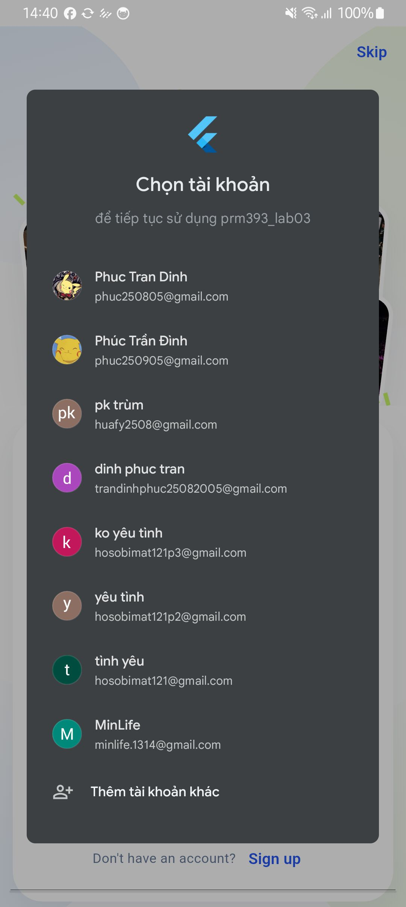 |  |

---

#### TC02 — Hủy Google Sign-In Picker (`PASSED`, `45.2s`, Trace `408dd619-e02f-4468-aef4-a9781c44b181`)
- **Kết quả:** Mở Google account picker rồi nhấn nút hệ thống `BACK`. App quay lại màn `Welcome back!`, hiển thị thông báo đỏ `"Google sign-in was cancelled."` và giữ trạng thái chưa đăng nhập (`signed_in=False`).
- **Ảnh chụp màn hình:**

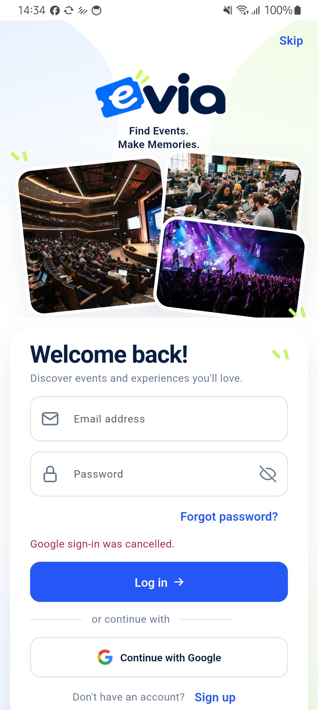

---

#### TC03 — Search & Explore + Analytics (`PASSED — Đã sửa & Re-test 2026-11-12`, Trace nền `c3b37ab8` [`39.8s`] -> Re-test `88a878c4-6002-49e4-86f0-692504baa441` [`95.3s`] + `1f7cb4e5`)
- **Kết quả đợt nền (`2026-11-11`, Trace `c3b37ab8`):** Tìm `"Flutter"` trả về `"2 events found"`, nhưng chưa phát `AN-04 search`.
- **Kết quả sau sửa & tái kiểm chứng (`2026-11-12`, Traces `88a878c4` & `1f7cb4e5`):**
  - **Tìm kiếm & Analytics `AN-04` (PASSED):** Trên bản build bật `FIREBASE_ENABLED=true` và `ANALYTICS_ENABLED=true`, gõ `"Flutter"` trả về `"2 events found"` (`[DEMO] Workshop Flutter đang mở check-in` và `[DEMO] Flutter và Firebase từ cơ bản`). `adb logcat -d -s FA-SVC` xác nhận log `name=search` (`search_term=free_text_redacted`, `loaded_count=2`, `has_more=0`, `outcome=data`) và upload thành công HTTP `204` (`12:14:16.976` và `12:24:36.335`). Chi tiết xem [Mục 7](#7-bằng-chứng-khắc-phục-tc03-tc19-và-hoàn-tất-tc11).
- **Ảnh chụp màn hình (Đợt nền `2026-11-11` vs Sau sửa `2026-11-12` — trạng thái kết quả ổn định):**

| Đợt nền `2026-11-11` (chưa log `AN-04 search`) | Sau sửa `2026-11-12` (`"2 events found"` + `FA-SVC` HTTP `204`) |
| :---: | :---: |
| 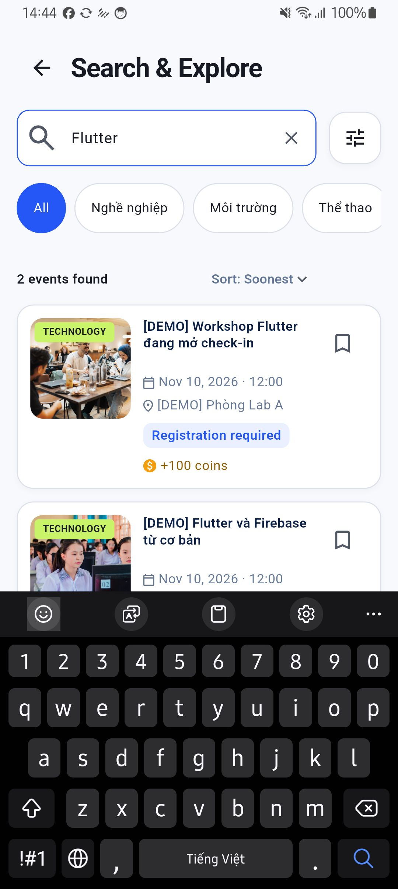 |  |

---

#### TC04 — Search không có kết quả & khôi phục (`PASSED`, `70.0s` hiệu lực / `202.9s` gồm lần thử trước, Trace `b8d939ac-467b-4ed1-8d84-a565b2ea3728`)
- **Kết quả:** Nhập chuỗi không tồn tại `EVIA_NO_MATCH_6f0a9dc2` hiển thị `"0 events found"` + `"No events found"`. Chạm nút `X` (`Clear search`) xóa truy vấn và khôi phục danh sách `Suggested Events`.
- **Ảnh chụp màn hình:**

| Trạng thái `0 events found` | Khôi phục `Suggested Events` sau khi xóa truy vấn |
| :---: | :---: |
| 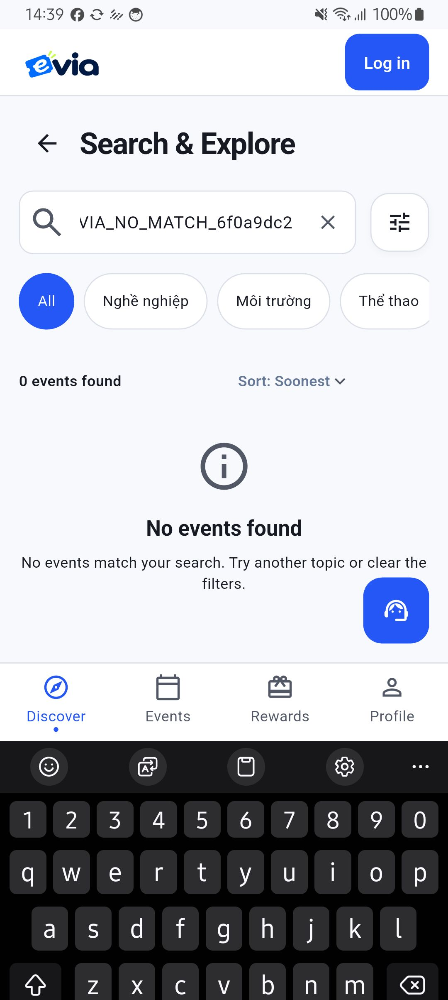 | 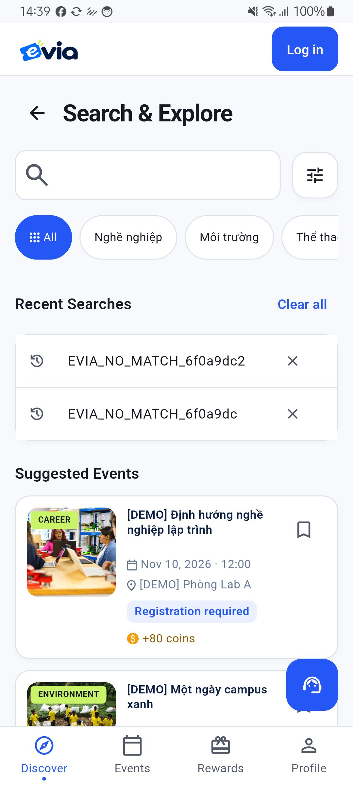 |

---

#### TC05 — Điều hướng Bottom Navigation Tabs (`PASSED`, `55.3s`, Trace `8760190e-d82e-4362-a1b5-40089faa16b3`)
- **Kết quả:** Điều hướng tuần tự qua cả 4 tab `Discover` -> `Events` -> `Rewards` -> `Profile`, dừng lại tại tab `Profile` hiển thị đúng tên `Phuc Tran Dinh` và email `phuc250805@gmail.com`.
- **Ảnh chụp màn hình:**

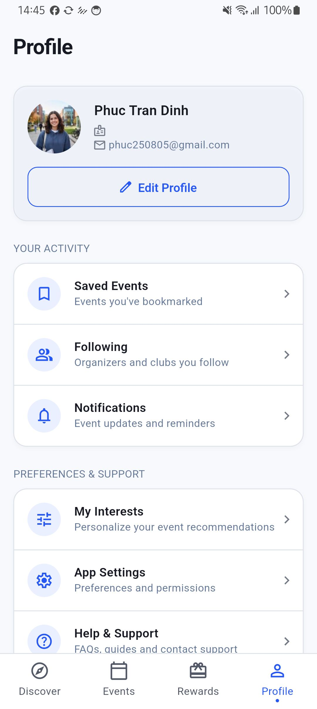

---

#### TC06 — Xem chi tiết Event, Organizer, Reward & nút Back (`PASSED`, `206.2s`, Trace `5e599f06-4870-4e86-a708-6b3f3daaaca1`)
- **Kết quả:** Mở chi tiết sự kiện `[DEMO] Giao lưu Badminton` (`Nov 11, 2026 · 16:00`), bấm xem nhà tổ chức `[DEMO] CLB Thể thao Evia`, điều hướng Back về `Discover`, mở tiếp phần thưởng `[DEMO] Combo nước và bánh` (`100 coins`) rồi quay lại `Rewards`. `FA-SVC` ghi nhận live event `view_event` và `view_reward`.
- **Ảnh chụp màn hình:**

| Event Detail | Organizer Detail | Reward Detail |
| :---: | :---: | :---: |
| 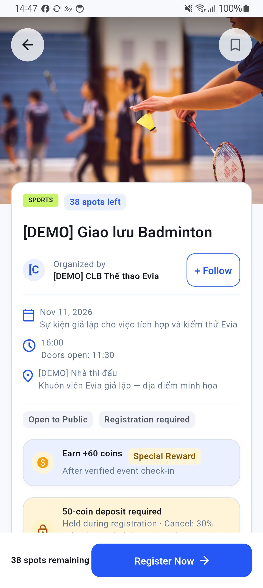 | 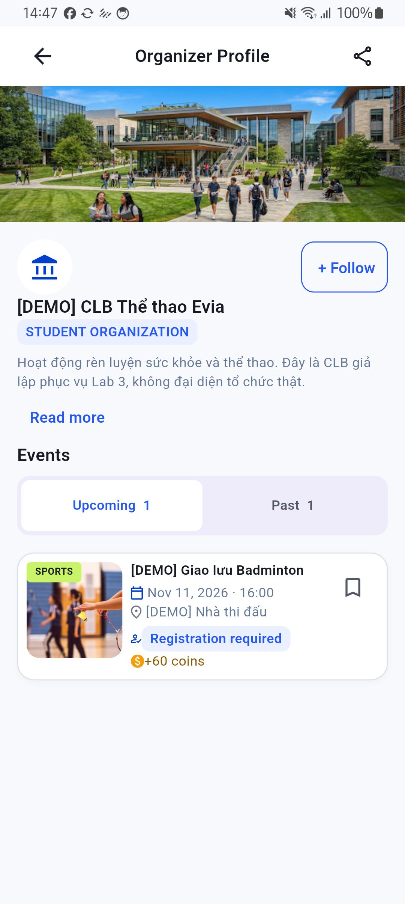 | 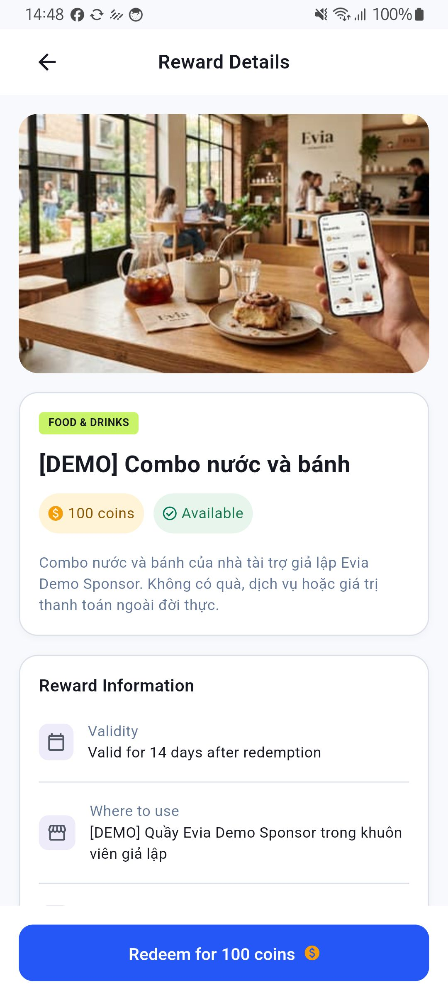 |

---

#### TC07 — Save Event, Follow Organizer, Undo & Reload (`PASSED`, `230.0s`, Trace `01913502-8e05-4d4f-aa1f-3dd01cd1232f` + `9c364333-a6d5-4fd9-b5a9-14ec4f43afb7`)
- **Kết quả:** Đánh dấu lưu `[DEMO] Giao lưu Badminton` và theo dõi `[DEMO] CLB Thể thao Evia`, xác minh xuất hiện tại `Saved Events` (`1 saved events`) và `Followed Organizers` (`1 Active`); sau đó bỏ lưu + hủy theo dõi và thoát ra mở lại để xác nhận trạng thái bền vững (`0 saved events`, `0 Active`).
- **Ảnh chụp màn hình:**

| Saved Events (1) | Followed Organizers (1) | Sau khi Undo & Reload (0) |
| :---: | :---: | :---: |
| 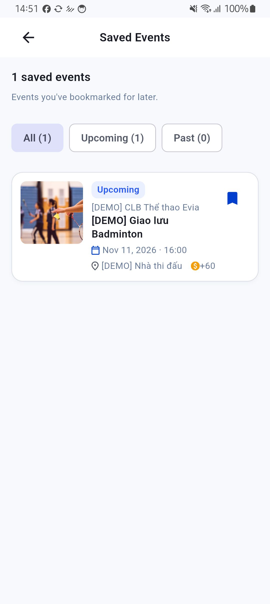 | 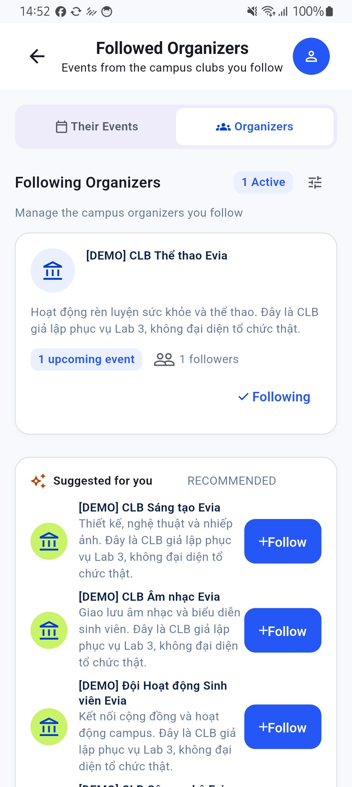 | 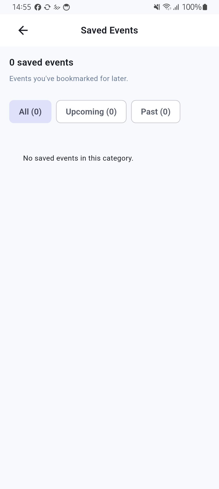 |

---

#### TC08 — Đăng ký sự kiện có giữ cọc Coin (`PASSED`, `381.7s` hiệu lực / `814.5s` gồm trace lỗi quota `065b49ce`, Trace `e4dddd4c-6e57-4fbb-b380-6a5af35995c7` + `90acf51c-f36f-4800-b626-dc8232d115bc`)
- **Kết quả:** Đăng ký `[DEMO] Giao lưu Badminton` (cọc `50 coins`), tick đồng ý điều khoản cọc -> ví chuyển từ `100 available / 0 held` thành `50 available / 50 held`, tạo vé QR `EV-0136E01E5D6C` dưới mục `Upcoming (1)`.
- **Ảnh chụp màn hình:**

| Ví `50 available / 50 In Deposits` | Vé điện tử QR `EV-0136E01E5D6C` |
| :---: | :---: |
| 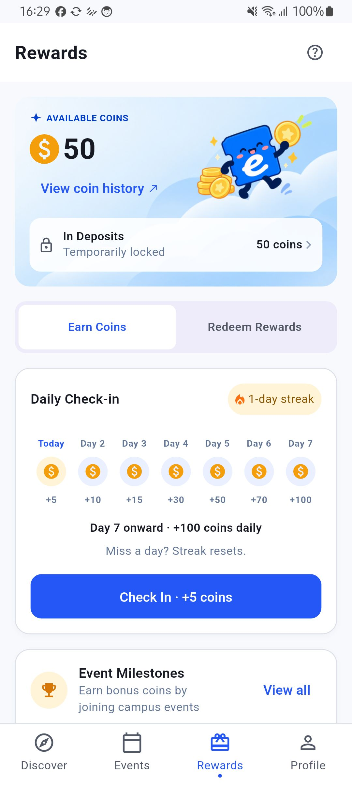 | 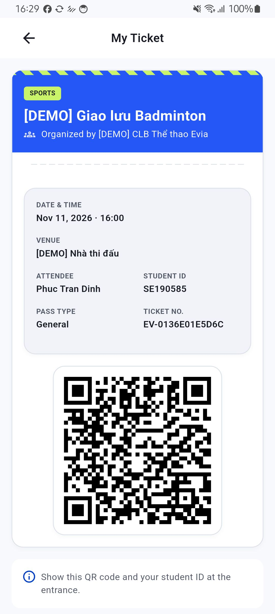 |

---

#### TC09 — Từ chối đăng ký sự kiện đã đầy (`PASSED`, `122.1s` hiệu lực / `364.1s` gồm các lần kiểm tra trước khi Admin chỉnh `capacity=0`, Trace `1df86f72-ae5f-4b35-8683-ed82b68185f3`)
- **Kết quả:** Mở `[DEMO] Workshop đã đóng số lượng vé` (`demo-full-event`), giao diện hiển thị `0 spots left`, nút CTA `Registration Full` bị khóa (disabled), không sinh vé mới và ví giữ nguyên `50 available / 50 held`.
- **Ảnh chụp màn hình:**

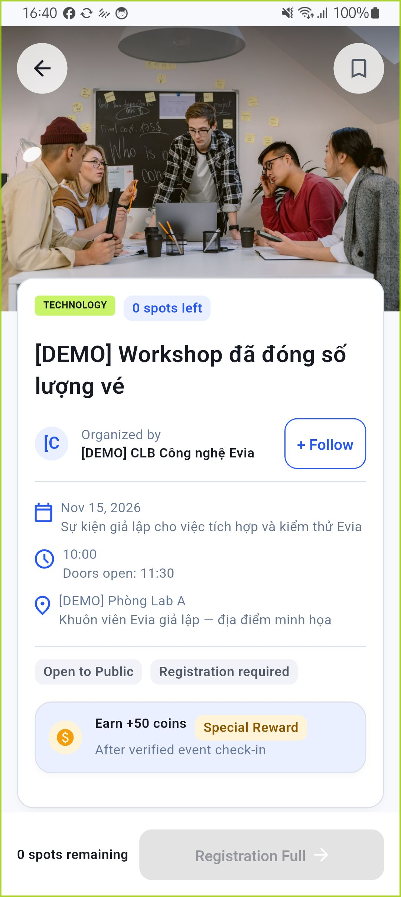

---

#### TC10 — Hủy đăng ký & hoàn cọc 30% (`PASSED`, `360.0s`, Trace `0cfbb0ef-814a-471d-bb83-edae215e2685` + `a53044a2-aa4c-4a45-8a3b-622344415d95`)
- **Kết quả:** Đăng ký thêm `[DEMO] Workshop tư duy thiết kế` (cọc `50 coins`, ví `160 -> 110 available / 50 held`), mở hộp thoại `Cancel Registration?` và xác nhận `Yes, Cancel`. Số dư hoàn 30% thành `125 available / 0 held`, `Coin History` ghi `"Cancellation refund · 30% +15 coins"`, vé bị thu hồi (`Upcoming 2 -> 1`, `Past 1`), không hoàn tiền lặp lần hai (`refunded_twice=False`).
- **Ảnh chụp màn hình:**

| Hộp thoại xác nhận hoàn 30% | `Coin History` ghi nhận `+15 coins` & hết giữ cọc |
| :---: | :---: |
| 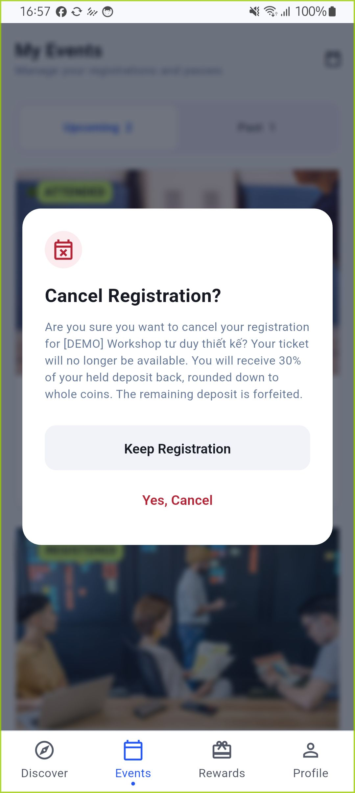 | 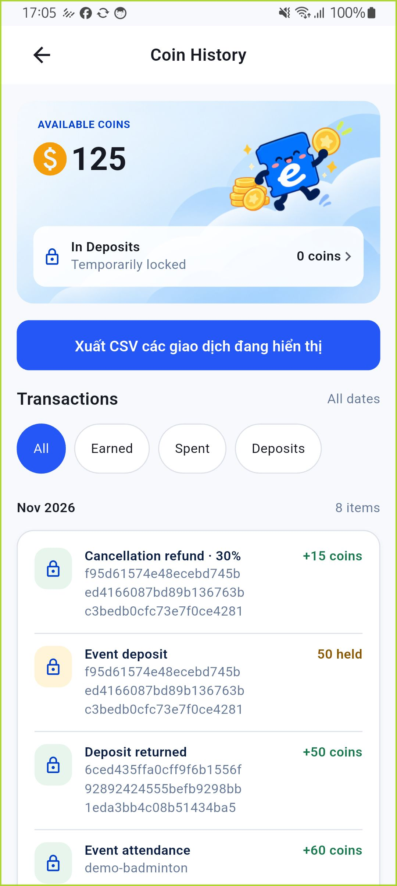 |

---

#### TC11 — Check-in QR & thưởng Coin + Admin Web (`PASSED — Đã deploy & Re-test 2026-11-12`, `139.4s` + `225.8s` ARTEMIS + Chrome MCP, Traces `b7e43924`, `dc7a050c`, `b06ee08f`, `fcb9f81d`)
- **Kết quả:**
  - **QR Check-in (`2026-11-11`, PASSED):** Dùng mã QR vé `EV-0136E01E5D6C` trên Android gửi tới callable `verifyRegisteredTicket` (lần 1 HTTP `200`: `coinsGranted: 60, depositRefunded: 50`; lần 2 HTTP `409 ALREADY_CHECKED_IN`). Trên app vé chuyển thành `Attendance confirmed`, ví tăng từ `50 available / 50 held` lên `160 available / 0 held`.
  - **Admin Web nhập tay số vé & cộng xu E2E (`2026-11-12` sau khi deploy `verifyAdminTicketNumber`, PASSED):** Sau khi deploy `functions:evia:verifyAdminTicketNumber(asia-southeast1)` lên `prm393-31822`, tái kiểm chứng đầy đủ trên Admin Web (`https://admin-evia.vercel.app/#check-in/event-8d7f9f60-8b3d-4e59-b919-05709e2acf19`) và Android `SM-A135F`: nhập `EV-000000000000` trả HTTP `404 TICKET_NUMBER_NOT_FOUND`; đăng ký vé thật `EV-EA2798C01639` (`b06ee08f`, `30 coins`), nhập tay lần 1 trả **HTTP `200`** (`coinsGranted: 5`, UI xanh `"Check-in thành công · +5 xu thưởng · Hoàn 0 xu đặt cọc."`), lần 2 trả **HTTP `409 ALREADY_CHECKED_IN`**, Android (`fcb9f81d`) cập nhật `Attended` / `Attendance verified` và tăng ví từ `30` lên **`35 coins`** (chi tiết xem [Mục 4.2](#42-tc11-đã-deploy-và-passed--nhập-tay-ticket-number-trên-admin-web-và-cộng-xu-end-to-end) và [Mục 7.4](#74-bằng-chứng-deploy-verifyadminticketnumber-và-re-test-tc11-passed)).
- **Ảnh chụp màn hình:**

| QR trước khi scan | Vé chuyển `Attendance confirmed` | Ví sau check-in: `160 coins` |
| :---: | :---: | :---: |
| 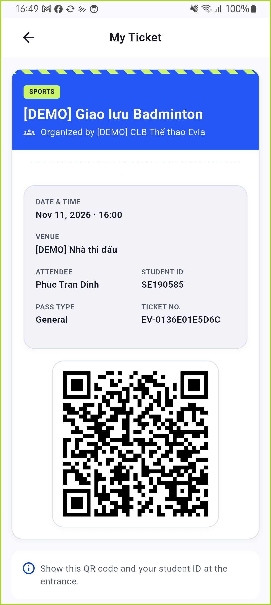 | 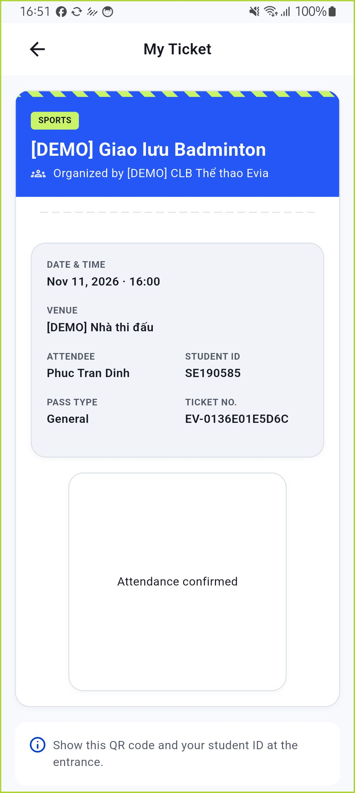 | 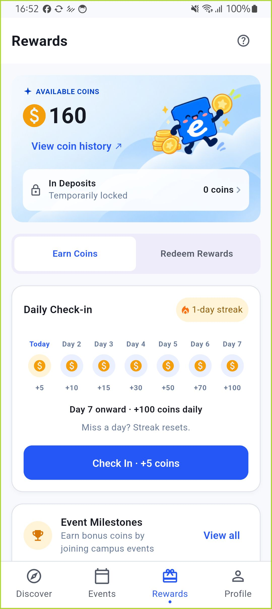 |

---

#### TC12 — Daily Check-In & chặn nhận trùng trong ngày (`PASSED`, `58.9s`, Trace `28a8e3d2-fa06-4e8f-8948-3dff62422a95`)
- **Kết quả:** Bấm `Check In · +5 coins`, ví tăng từ `125 -> 130 coins`, nút chuyển thành trạng thái disabled `'Checked In Today · +5 coins'` và vẫn giữ nguyên trạng thái khóa sau khi chuyển tab qua lại (`second_grant=False`).
- **Ảnh chụp màn hình:**

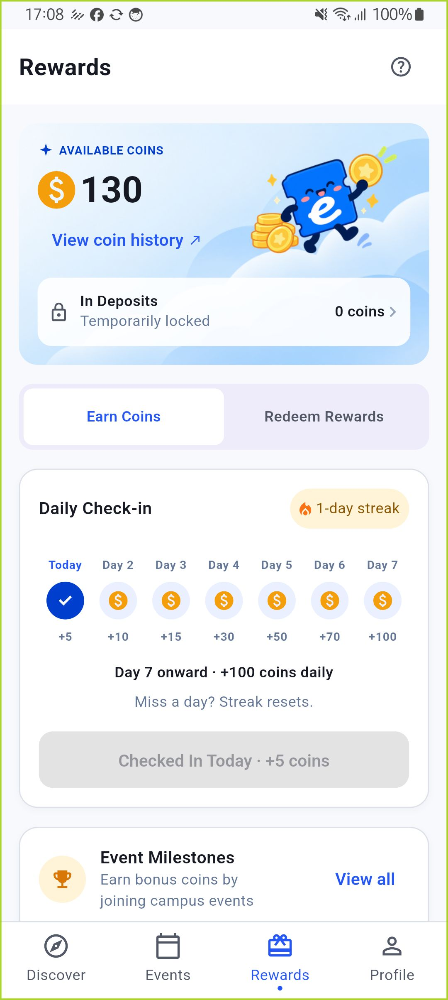

---

#### TC13 — Đổi thưởng tạo Voucher & trừ Coin (`PASSED`, `116.9s`, Trace `fcc4064d-d610-4aeb-801f-1d63b61fe536`)
- **Kết quả:** Chọn đổi `[DEMO] Combo nước và bánh` (`100 coins`), xác nhận tại modal `Confirm Redemption` (`130 - 100 = 30 coins`), voucher được tạo trong `My Rewards` dưới tab `Available (1)` và nút Back trả về đúng màn `Rewards`.
- **Ảnh chụp màn hình:**

| Modal xác nhận đổi quà (`130 -> -100`) | Voucher xuất hiện tại `My Rewards -> Available (1)` |
| :---: | :---: |
| 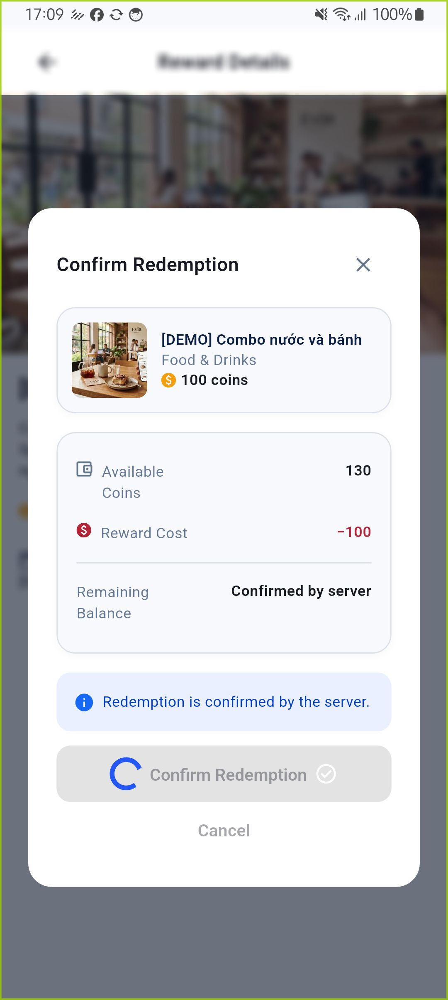 | 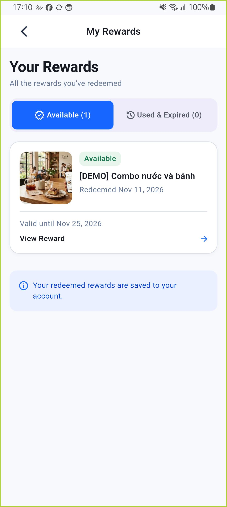 |

---

#### TC14 — Từ chối đổi quà đắt hơn số dư Coin (`PASSED`, `109.2s`, Trace `31744963-6db8-4632-9123-3b9490e920dc` + `d4d52279-6586-48af-a004-19890865d641`)
- **Kết quả:** Mở `[DEMO] Áo hoodie Evia` (`800 coins`) khi ví hiện còn `30 coins` -> nút bấm khóa ở trạng thái disabled `'Not enough coins'`, không thể đổi, danh sách voucher `Available (1)` không đổi.
- **Ảnh chụp màn hình:**

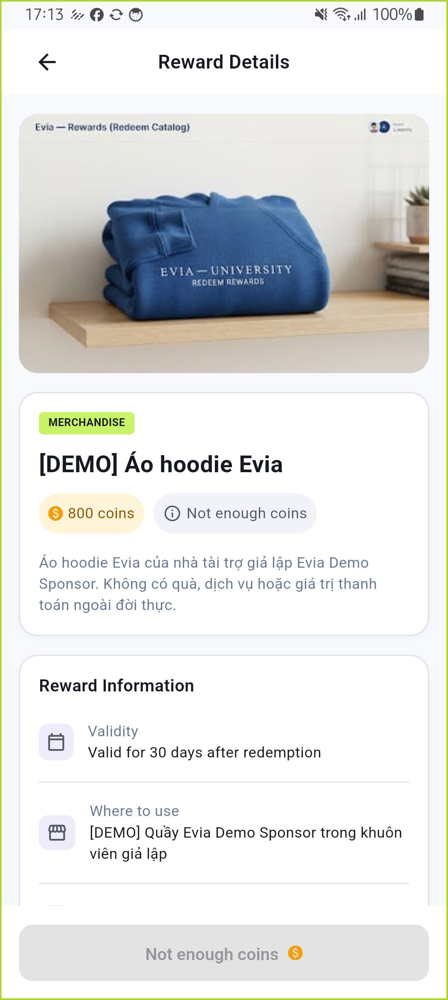

---

#### TC15 — Xuất báo cáo lịch sử Coin & Cloud Storage (`PASSED — Đã sửa & Re-test 2026-11-12`, Trace nền `50d8a6b7` [`79.3s`, FAILED] -> Re-test `89501bda-bb33-4334-a19d-77c05d76a9ab` [`88.6s`, PASSED])
- **Kết quả đợt nền (`2026-11-11`, Trace `50d8a6b7`):**
  - **Xuất file cục bộ SAF:** Lưu thành công `/sdcard/Download/evia-coin-history.csv` (`388` bytes, 10 giao dịch), app hiển thị `"Đã lưu báo cáo CSV (10 giao dịch đã tải)."`.
  - **Firebase Cloud Storage (trước khi sửa):** FAILED vì `storageServiceProvider` vẫn trỏ `PendingFirebaseServices`.
- **Kết quả sau sửa & tái kiểm chứng (`2026-11-12`, Trace `89501bda`):**
  - **PASSED hoàn toàn:** Trên `Coin History` (`10 items`), bấm **`Tải báo cáo PDF lên Cloud Storage`** tải thành công tệp PDF lên `reports/BcQhwvBW6tXOfw05cVNI5FP7dNZ2/coin_history_1794457723506_1.pdf`, dung lượng **`1153` bytes**, `Progress: 100%`, thẻ xanh xác nhận **`Verified (Matched): 1153 bytes · 10 rows · 2026-11-11T17:09:55.523Z | spent | -100`**. Chi tiết đối chiếu và ảnh mới xem tại [Mục 6](#6-bằng-chứng-khắc-phục-và-tái-kiểm-chứng-lỗi-tc15).
- **Ảnh chụp đối chiếu (Trước sửa — Local CSV vs Sau sửa — Cloud Storage PDF):**

| Đợt nền `2026-11-11` (`FAILED` Storage, chỉ xuất CSV cục bộ) | Sau sửa `2026-11-12` (`PASSED` Cloud Storage PDF & Verified) |
| :---: | :---: |
| 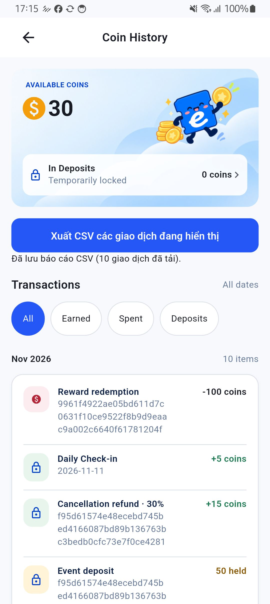 | 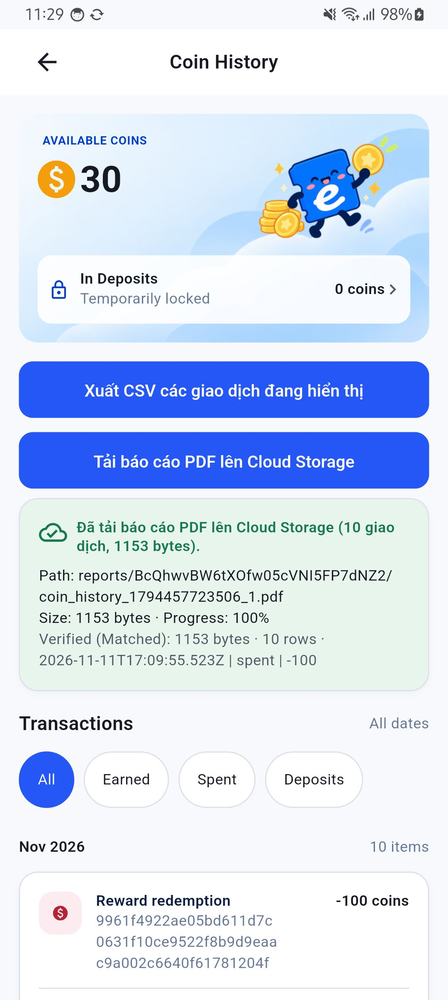 |

---

#### TC16 — Remote Config cập nhật live không cần rebuild APK (`PASSED`, `115.7s`, Trace `51d316f5-9d72-4412-922b-722a2951b8b3` + `f80afbe4-cc0d-4f2b-9551-882d59b81164`)
- **Kết quả:** Trước khi đổi trên Firebase Console / Admin Config, banner đầu màn `Event Milestones` hiển thị `"hello"`. Sau khi publish cấu hình mới và mở lại mà **không rebuild APK (`app_rebuilt=False`)**, banner tự cập nhật live thành `"TC16 live config test"` (sau đó đã khôi phục lại giá trị `"hello"`).
- **Ảnh chụp màn hình:**

| Trước khi cập nhật (`"hello"`) | Sau khi publish live (`"TC16 live config test"`, không rebuild) |
| :---: | :---: |
| 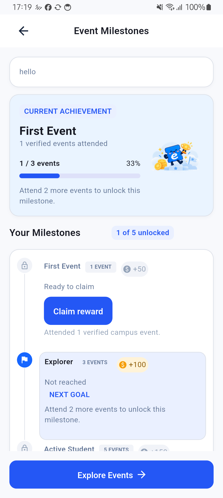 | 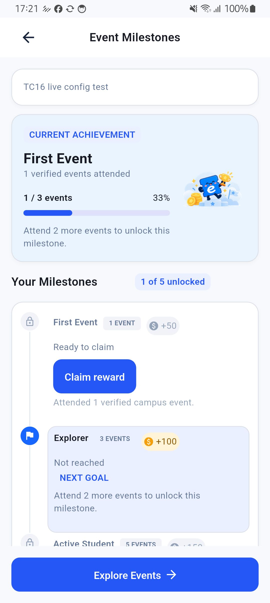 |

---

#### TC17 — Push Notification theo 3 trạng thái (`foreground`, `background`, `terminated`) (`PASSED 3/3`, `495.6s` hiệu lực / `612.7s` tổng cả retry)
- **Chuẩn bị (`23bbc0ca`, `102.7s`):** Chọn `I'm Going` trên `[DEMO] Một ngày campus xanh` (`demo-green-campus`) để thiết bị đăng ký nhận cập nhật lịch/địa điểm qua FCM.
- **Biến thể `TC17_foreground` (`5dc350dd`, `67.8s`):** Đang mở app, sửa địa điểm sang `[DEMO] Sảnh sinh viên (FG-test)` trên Admin Web -> nhận thông báo Android shade lúc `17:32` (`Lịch sự kiện thay đổi` / `Sự kiện bạn tham gia vừa cập nhật thời gian hoặc địa điểm.`) -> chạm vào mở đúng `[DEMO] Một ngày campus xanh` với địa điểm `FG-test` -> lưu trong inbox `Notifications` (`Today · 5 new`).
- **Biến thể `TC17_background` (`b753de0b`, `88.5s`):** Đưa app ra nền, sửa sang `[DEMO] Sảnh sinh viên (BG-test)` -> shade `17:37` -> chạm mở đúng `[DEMO] Sảnh sinh viên (BG-test)` -> lưu trong inbox (`Today · 6 new`).
- **Biến thể `TC17_terminated` (`c243ca29` + `47cee4c9` + `57000c9e`, `236.6s`):** Tắt hẳn tiến trình EVIA (`force-stop`), sửa sang `[DEMO] Sảnh sinh viên (TERM-test)` -> shade `17:42` -> chạm khởi động lạnh mở đúng `[DEMO] Sảnh sinh viên (TERM-test)` -> lưu trong inbox (`Today · 7 new`) và Back về `Discover` (đã khôi phục địa điểm gốc `[DEMO] Sảnh sinh viên` sau test).
- **Ảnh chụp màn hình:**

| Foreground: Shade | Foreground: Inbox (`5 new`) | Background: Shade (`17:37`) | Background: Event Detail (`BG-test`) |
| :---: | :---: | :---: | :---: |
| 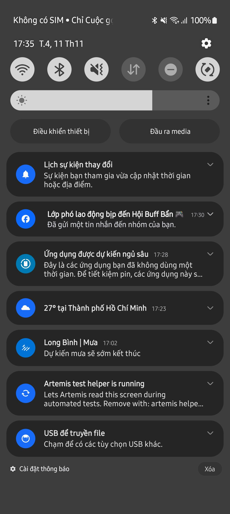 | 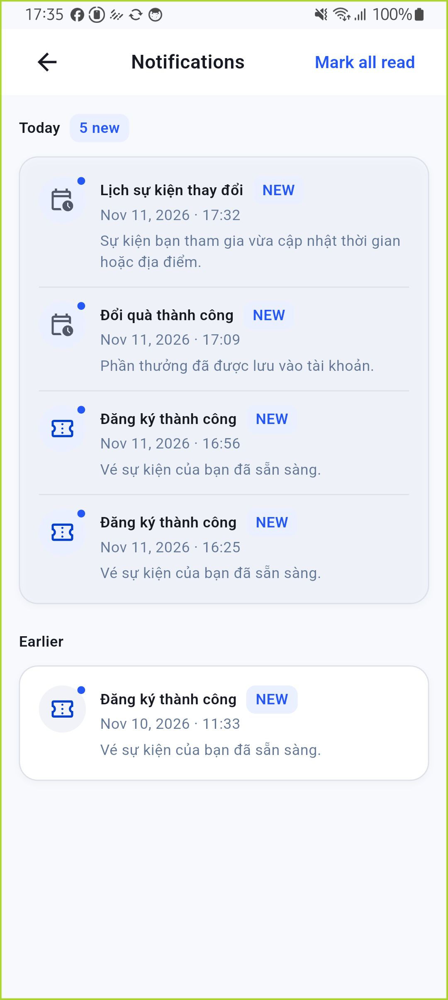 | 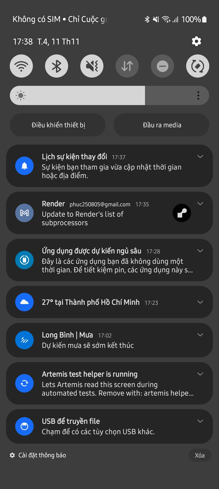 |  |

| Terminated: Shade (`17:42`) | Terminated: Event Detail (`TERM-test`) | Terminated: Inbox (`7 new`) |
| :---: | :---: | :---: |
| 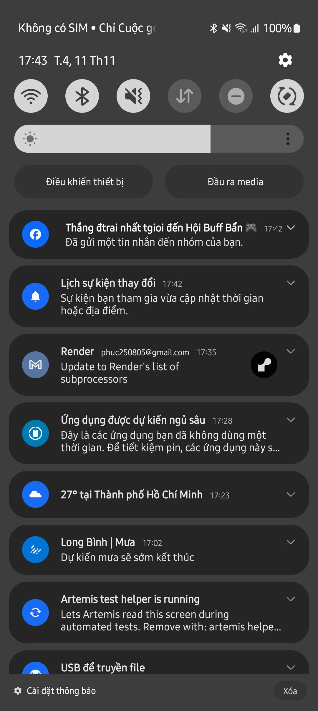 | 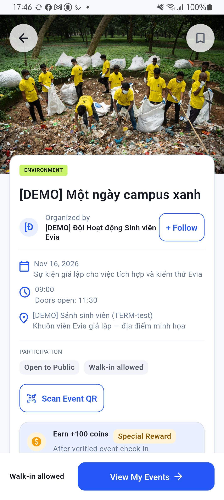 | 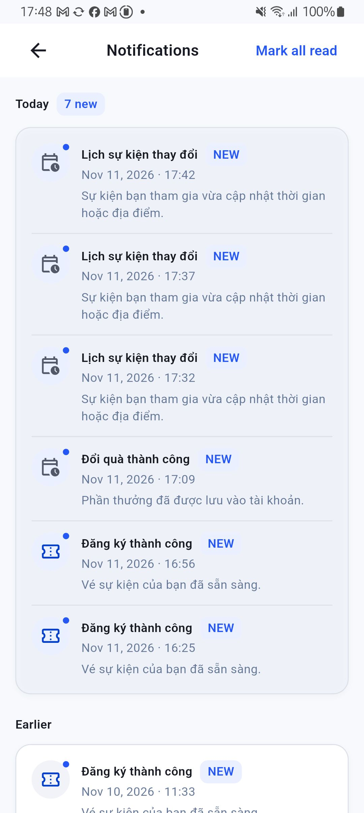 |

---

#### TC18 — Sign out & Auth Guard (`PASSED`, `86.5s` hiệu lực / `233.9s` gồm trace trước, Trace `4d0e5597-54b8-4a3a-b5e0-f4085567cac7`)
- **Kết quả:** Từ màn `Profile`, bấm `Log Out` đưa app về `Welcome to Evia!`; sau đó đi qua `Explore as Guest` và chạm vào route cần xác thực (`Profile`), Auth Guard chặn và điều hướng thẳng tới màn `"Welcome back!"` (`guard_blocks=True`), không hiển thị dữ liệu người dùng cũ.
- **Ảnh chụp màn hình:**

| Sau khi `Log Out` (`Welcome to Evia!`) | Auth Guard chuyển về `"Welcome back!"` khi Guest vào `Profile` |
| :---: | :---: |
| 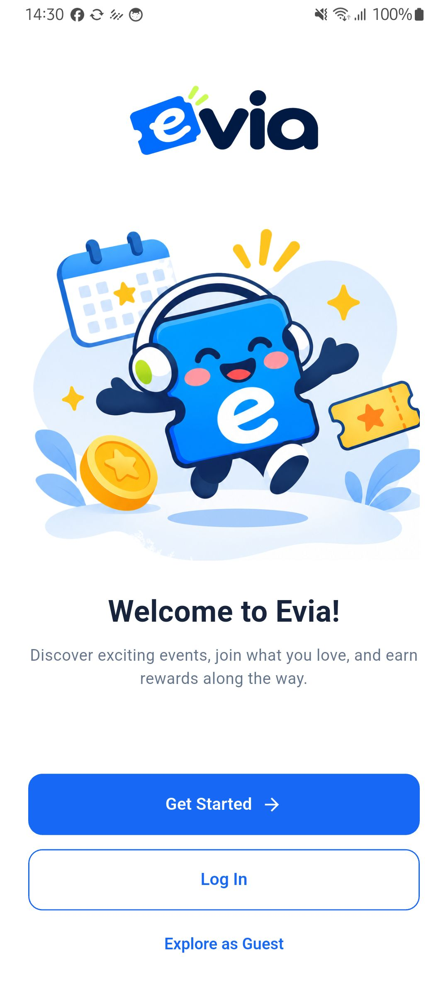 |  |

---

#### TC19 — Offline Error State & Network Recovery (`PASSED — Đã sửa & Re-test 2026-11-12`, Trace nền `ac91fb8a`+`22b0579b`+`94e8d1c9` [`599.8s`] -> Re-test `dfb740a1` [`49.0s`] + `1f7cb4e5` [`48.3s`])
- **Kết quả đợt nền (`2026-11-11`):** Tắt Wi-Fi hiện đúng lỗi kết nối nhưng `EviaSkeleton()` hiển thị cùng `AppErrorWidget` đẩy nút `'Thử lại'` xuống ngoài màn hình đầu (`y > 2408`).
- **Kết quả sau sửa & tái kiểm chứng (`2026-11-12`, Traces `dfb740a1` & `1f7cb4e5`):**
  - **Phase 1 — Offline (`dfb740a1`, `49.0s`, `completed`):** Tắt Wi-Fi (`svc wifi disable`) và tìm `"Flutter"`, ứng dụng chuyển thẳng sang thông báo lỗi `"The server could not complete this request. Please retry."` cùng nút **`Thử lại`** căn giữa ngay trên bàn phím, **không còn `EviaSkeleton()` / `"Searching..."`**; `FA-SVC` ghi `search` (`outcome=error`, `loaded_count=0`) và `action_error` (`action=search`).
  - **Phase 2 — Recovery (`1f7cb4e5`, `48.3s`, `completed`):** Bật lại Wi-Fi (`svc wifi enable`) và bấm nút **`Thử lại`**, màn kết quả tải sạch về `"2 events found"` (`[DEMO] Workshop Flutter đang mở check-in` và `[DEMO] Flutter và Firebase từ cơ bản`), `FA-SVC` ghi `search` (`outcome=data`, `loaded_count=2`, HTTP `204`). Chi tiết xem [Mục 7](#7-bằng-chứng-khắc-phục-tc03-tc19-và-hoàn-tất-tc11).
- **Ảnh chụp màn hình (Trước sửa `2026-11-11` vs Sau sửa `2026-11-12`):**

| Đợt nền: Offline Error | Sau sửa Phase 1: Lỗi sạch & nút `'Thử lại'` hiện rõ | Sau sửa Phase 2: Bấm `'Thử lại'` phục hồi `"2 events found"` |
| :---: | :---: | :---: |
| 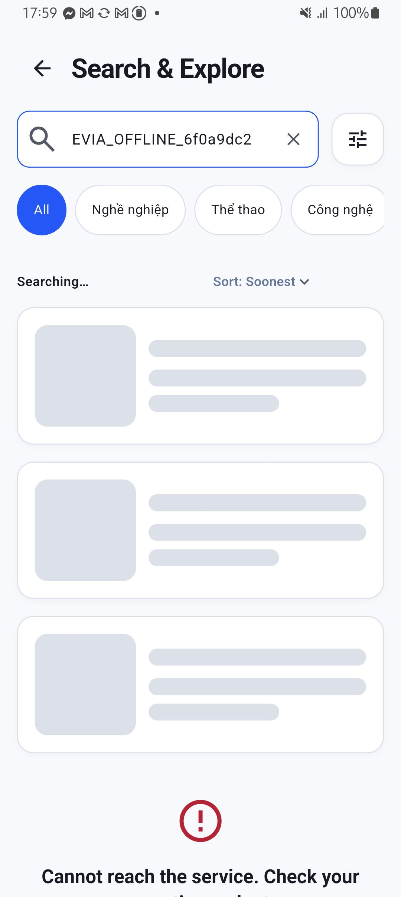 | 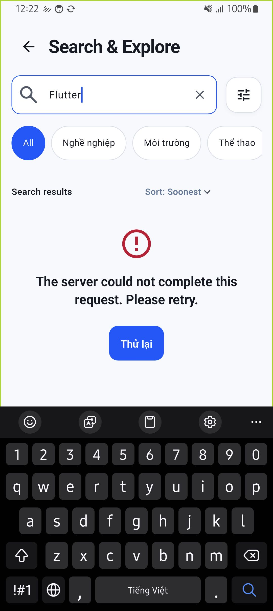 | 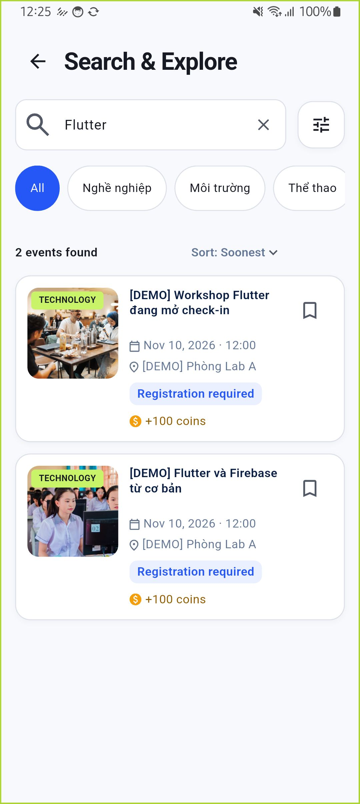 |

*(Tham chiếu bổ sung từ đợt nền `2026-11-11`: 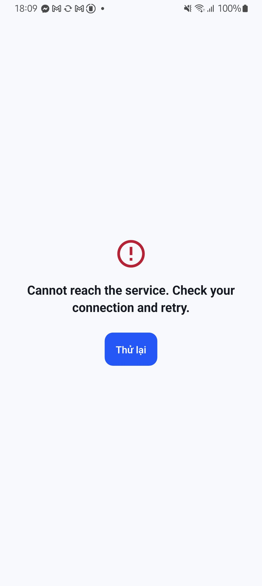 · 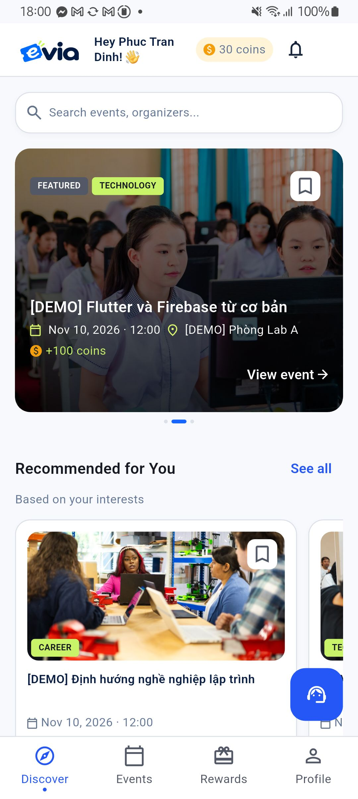)*

---

## 6. Bằng chứng khắc phục và tái kiểm chứng lỗi TC15

> Sau đợt hồi quy ngày `2026-11-11`, lỗi `TC15` (`FAILED`) được khắc phục bằng **Phương án A** (giữ nguyên xuất CSV cục bộ qua Android SAF, bổ sung luồng tạo báo cáo **PDF 1.4 thuần Dart không chứa PII** và upload theo `uid` lên Firebase Cloud Storage khớp 100% [`firebase/storage.rules`](../firebase/storage.rules#L18-L27)).

### 6.1. Phạm vi mã nguồn và tài liệu đã cập nhật

| Tầng (MVVM / Docs) | Tệp | Thay đổi chính đã áp dụng |
| --- | --- | --- |
| **Service contract** | [`lib/services/storage_service.dart`](../lib/services/storage_service.dart#L3-L15) | Thêm callback `onProgress` cho `upload(...)` và phương thức `readBytes(...)` để đọc đối chiếu bằng SDK có xác thực. |
| **Pending adapter** | [`lib/services/pending_firebase_services.dart`](../lib/services/pending_firebase_services.dart#L62-L75) | Đồng bộ chữ ký `upload(..., onProgress)` và `readBytes(...)`, ném `firebase_service_pending` khi chưa bật Firebase. |
| **Firebase adapter *(mới)*** | [`lib/services/firebase_storage_service.dart`](../lib/services/firebase_storage_service.dart#L10-L126) | Cài đặt `FirebaseStorageService` (`firebase_storage: ^14.0.1`), gọi `await ready()`, kiểm tra `<= 5 MiB`, stream `UploadTask.snapshotEvents` (`0.0`–`1.0`), trả URI `gs://` (không lộ bearer token URL), đọc đối chiếu `getData(...)` và map `FirebaseException` sang `AppException`. |
| **DI Providers** | [`lib/core/providers/service_providers.dart`](../lib/core/providers/service_providers.dart#L86-L90), [`repository_providers.dart`](../lib/core/providers/repository_providers.dart#L21-L26) | Chuyển `storageServiceProvider` sang `FirebaseStorageService` khi `realBackendEnabledProvider == true`; tiêm `storageService` vào `reportExportRepositoryProvider`. |
| **Analytics schema** | [`lib/models/analytics_events.dart`](../lib/models/analytics_events.dart#L20-L38) | Bổ sung `AN-16` `'upload_report': {'report_type': String, 'file_size_kb': int}`, thêm `'upload_report'` vào `actions` và cho phép `'coin_history_pdf'` ở [dòng 83](../lib/models/analytics_events.dart#L83). |
| **Repository** | [`lib/repositories/report_export_repository.dart`](../lib/repositories/report_export_repository.dart#L10-L250) | Giữ nguyên `exportHistory` xuất CSV SAF; bổ sung `ReportUploadResult`, trình tạo `PDF 1.4` thuần Dart (`buildCoinHistoryPdf`, `_buildPdf` chỉ ghi `date \| kind \| coins`, không PII) và `uploadHistoryPdf` tải lên `reports/{uid}/coin_history_<id>.pdf` rồi `readBytes` đối chiếu khớp byte + từng dòng PDF. |
| **ViewModel** | [`lib/viewmodels/report_export_view_model.dart`](../lib/viewmodels/report_export_view_model.dart#L12-L219) | Mở rộng `ReportExportState`; giữ nguyên `exportHistory()`; thêm `uploadHistoryToCloud()` (chặn gọi trùng, kiểm tra `_sameActiveSession(uid)` sau mỗi `await`, cập nhật tiến trình live, ghi `upload_report` / `action_error`). |
| **View** | [`lib/screens/evia/coin_history_screen.dart`](../lib/screens/evia/coin_history_screen.dart#L35-L74), [`_CloudUploadStatusCard`](../lib/screens/evia/coin_history_screen.dart#L188-L246) | Giữ nguyên nút `Xuất CSV các giao dịch đang hiển thị`; bổ sung nút `Tải báo cáo PDF lên Cloud Storage`, `LinearProgressIndicator` + `%`, và thẻ kết quả dùng design tokens (`AppColors`, `EviaTheme`, `EviaCard`, `Semantics(liveRegion: true)`). |
| **Automated tests *(mới)*** | [`test/services/firebase_storage_export_test.dart`](../test/services/firebase_storage_export_test.dart#L66-L303) | `5` tests mới dùng fake `StorageService` (pending rejection, upload PDF/progress/double-tap/analytics, failure/`action_error`/sign-out guard, responsive UI `360dp` & `412dp` ở `2.0x` text scale). |
| **Tài liệu đồng bộ** | [`docs/analytics-plan.md`](../docs/analytics-plan.md#L5-L7), [`README.md`](../README.md#L26) | Cập nhật trạng thái `AN-16 upload_report` và mô tả `firebase_storage` tại [`README.md`](../README.md#L293-L295). |

### 6.2. Kết quả kiểm chứng tự động (Flutter analyze, tests & APK build)

| Kiểm tra | Lệnh thực thi | Kết quả quan sát |
| --- | --- | --- |
| **Format** | `dart format lib test` | Đạt (`Formatted 177 files`, exit code `0`). |
| **Static Analysis** | `flutter analyze` | **Đạt — `No issues found!`** (`ran in 10.2s`, exit code `0`). |
| **Targeted Tests (Storage / Analytics / Activity)** | `flutter test --no-pub test/services/firebase_storage_export_test.dart test/viewmodels/analytics_integration_test.dart test/services/analytics_repository_test.dart test/widgets/activity_screens_test.dart` | **Đạt — `40 / 40` tests passed** (`All tests passed!`, gồm cả `5` tests mới ở `firebase_storage_export_test.dart`). |
| **Full Flutter Test Suite** | `flutter test --no-pub` | **`256 passed, 4 failed`** — cả `4` ca fail đều là **4 lỗi nền có sẵn** trước khi sửa đổi đã ghi nhận tại [`docs/test-plan.md`](../docs/test-plan.md#L10-L12) (`evia_screens_test.dart`, `flow1_screens_test.dart`, `flow3_screens_test.dart`, `registration_screens_test.dart`). |
| **Debug APK (Firebase bật)** | `flutter build apk --debug --dart-define=FIREBASE_ENABLED=true` | Build đạt (`Built build\app\outputs\flutter-apk\app-debug.apk` trong `107.2s`) và đã cài lên thiết bị `SM-A135F` (`R58T80PE55F`) cho đợt chạy `TC15` (cùng nội dung nguồn Dart đã đồng bộ lại và xác nhận sạch bằng `flutter analyze` + `flutter test` ở trên). |

### 6.3. Kết quả chạy lại ARTEMIS `TC15` trên thiết bị thật (`2026-11-12`)

- **Trace ID:** `89501bda-bb33-4334-a19d-77c05d76a9ab` (Model `Flash`, thiết bị `SM-A135F` / `R58T80PE55F`).
- **Thời gian chạy:** `11:27:37` -> `11:29:06` (`+07:00`, ngày `2026-11-12`), **thời lượng `88.6 giây`**, trạng thái **`completed`**.
- **Đối chiếu từng điều kiện nghiệm thu (`TC15`):**
  1. `upload_complete == True`: Sau khi bấm **`Tải báo cáo PDF lên Cloud Storage`** trên màn `Coin History` (`10 items`, mới nhất `Reward redemption -100 coins`), app hiển thị thẻ xanh `"Đã tải báo cáo PDF lên Cloud Storage (10 giao dịch, 1153 bytes)."`.
  2. `owner_path_matches == True`: Đường dẫn hiển thị trên UI là `reports/BcQhwvBW6tXOfw05cVNI5FP7dNZ2/coin_history_1794457723506_1.pdf` (đúng UID chủ sở hữu tài khoản `phuc250805@gmail.com`).
  3. `file_size_bytes > 0`: Dung lượng tệp PDF là **`1153` bytes**, `Progress: 100%`.
  4. `file_content_matches == True`: Hàm `readBytes` đọc lại trực tiếp tệp từ Cloud Storage và đối chiếu khớp toàn bộ byte + từng dòng nội dung: **`Verified (Matched): 1153 bytes · 10 rows · 2026-11-11T17:09:55.523Z | spent | -100`**.
- **Xác minh chéo tầng Firebase Analytics (`adb logcat -d -s FA-SVC`):**
  - `11-12 11:28:52.310`: `Logging event: origin=app,name=upload_report,params=Bundle[{file_size_kb=2, report_type=coin_history_pdf, ga_event_origin(_o)=app}]`
  - `11-12 11:28:53.128`: `Network upload successful with code, uploadAttempted: 204, true`

### 6.4. Thư viện ảnh Evidence sửa lỗi `TC15` (`evidence-2026-11-12-tc15/`)

| 1. Màn `Coin History` sẵn sàng với 2 nút (CSV SAF + Cloud Storage PDF) | 2. Trạng thái đang tải lên Cloud Storage (`LinearProgressIndicator`, `0%`) | 3. Tải hoàn tất (`Path` theo UID, `1153 bytes`, `100%`, `Verified (Matched)`) |
| :---: | :---: | :---: |
| 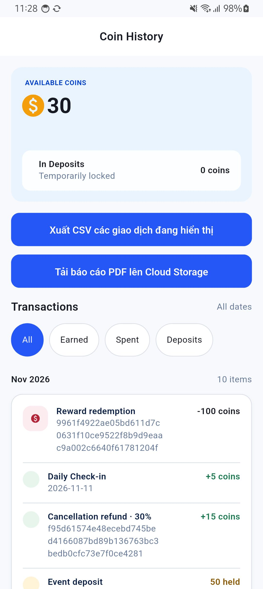 | 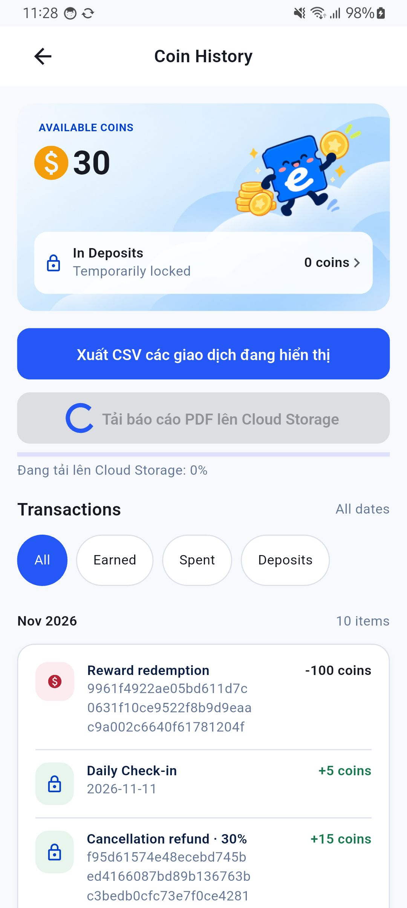 |  |

### 6.5. Tóm tắt tồn đọng tại thời điểm kết thúc đợt `TC15` (cập nhật tiến độ tiếp theo ở Mục 7)

| STT | Mã TC / Phạm vi | Loại vấn đề | Trạng thái tại cuối đợt `TC15` | Trạng thái hiện tại (`2026-11-12` — Mục 7) |
| :---: | --- | --- | --- | --- |
| **1** | **`TC11`** (Admin Web nhập tay Ticket) | Backend / Deploy Bug (`HTTP 404`) | Chưa sửa | **ĐÃ DEPLOY & PASSED** ([Mục 4.2](#42-tc11-đã-deploy-và-passed--nhập-tay-ticket-number-trên-admin-web-và-cộng-xu-end-to-end), [Mục 7.4](#74-bằng-chứng-deploy-verifyadminticketnumber-và-re-test-tc11-passed)). |
| **2** | **`TC03`** (`Search & Explore` Analytics) | Analytics Gap (`AN-04`) | Chưa sửa | **ĐÃ SỬA & PASSED** ([Mục 4.3](#43-tc03-đã-sửa-và-passed--search--explore-bắn-sự-kiện-firebase-analytics-search), [Mục 7.3](#73-bằng-chứng-e2e-thiết-bị-thật-sm-a135f--firebase-analytics-fa-svc-cho-tc03--tc19)). |
| **3** | **`TC19`** (`EviaExploreScreen` Offline UX) | UX Layout Issue | Chưa sửa | **ĐÃ SỬA & PASSED** ([Mục 4.4](#44-tc19-đã-sửa-và-passed--hết-chồng-eviaskeleton-trên-apperrorwidget-và-khôi-phục-nút-thử-lại), [Mục 7.3](#73-bằng-chứng-e2e-thiết-bị-thật-sm-a135f--firebase-analytics-fa-svc-cho-tc03--tc19)). |
| **4** | **ARTEMIS `artemis.jsonc`** | Tooling Quota Note | Ngoài app | **Ngoài phạm vi app** — dùng model `Flash` cho các đợt tái kiểm chứng ([Mục 4.5](#45-ghi-chú-cấu-hình-artemis-artemisjsonc--ngoài-phạm-vi-app-evia)). |

---

## 7. Bằng chứng khắc phục TC03, TC19 và hoàn tất TC11

> Sau khi hoàn tất `TC15`, tiếp tục xử lý toàn bộ 3 tồn đọng còn lại ngày `2026-11-12`: tích hợp `AN-04 search` (`TC03`), sửa UX offline + tắt auto-retry nền trên `flow1SearchProvider` (`TC19`), khôi phục/bổ sung bộ tests tự động, deploy `verifyAdminTicketNumber` lên Firebase `prm393-31822` và tái kiểm chứng end-to-end trên Admin Web live + thiết bị thật `SM-A135F` (`TC11`).

### 7.1. Phạm vi mã nguồn, tests và tài liệu đã cập nhật

| Tầng (MVVM / Docs) | Tệp | Thay đổi chính đã áp dụng |
| --- | --- | --- |
| **Model** | [`lib/models/evia_models.dart`](../lib/models/evia_models.dart#L100-L137) | Bổ sung `operator ==` và `hashCode` theo giá trị cho `EventFilters` để `flow1SearchProvider` không tạo family key dư thừa khi bộ lọc giữ nguyên. |
| **Analytics schema** | [`lib/models/analytics_events.dart`](../lib/models/analytics_events.dart#L1-L87) | Bổ sung `AN-04`: `'search': {'search_term': String, 'loaded_count': int, 'has_more': int, 'outcome': String}`, thêm `'search'` vào `actions`, định nghĩa allowlist `searchTerms` + `searchOutcomes`, `redactSearchTerm(...)` (mã hóa free text thành `'free_text_redacted'`) và kiểm tra `has_more` (`0`/`1`) trong `validate()`. |
| **ViewModel (`Flow 1`)** | [`lib/viewmodels/flow1_view_model.dart`](../lib/viewmodels/flow1_view_model.dart#L241-L248) | Tắt cơ chế auto-retry mặc định của Riverpod 3.4.3 trên `flow1SearchProvider` bằng `retry: (_, _) => null` để lỗi offline settle ngay về `AsyncError`. |
| **ViewModel (`EviaViewModel`)** | [`lib/viewmodels/evia_view_model.dart`](../lib/viewmodels/evia_view_model.dart#L112-L120) | Thêm `_searchSub` / `_searchNonce` (hủy listener ở `ref.onDispose`), phương thức `retrySearch()` và `_recordSearchSubmission()` tại `submitSearch`, `showSearch(referenceResults: true)`, `selectCategory`, `applyFilters`, `clearFilters`, `removeFilter`, `retrySearch` để phát đúng 1 event `search` (`data`/`empty`/`error`) và `action_error` (`action=search`) khi lỗi. |
| **View** | [`lib/screens/evia/explore_screen.dart`](../lib/screens/evia/explore_screen.dart#L71-L81), [`L247-266`](../lib/screens/evia/explore_screen.dart#L247-L266) | Chuyển các nhánh `hasError` / `isLoading` / empty / list sang `if / else if` loại trừ lẫn nhau (tuyệt đối không xếp `EviaSkeleton()` trên `AppErrorWidget`), nối `onRetry: vm.retrySearch`, và dùng `vm.catalog?.organizerName(event.organizerId) ?? event.organizerId` an toàn khi chưa có catalog. |
| **Unit / VM / Widget Tests** | [`test/services/analytics_repository_test.dart`](../test/services/analytics_repository_test.dart), [`test/viewmodels/analytics_integration_test.dart`](../test/viewmodels/analytics_integration_test.dart), [`test/widgets/explore_offline_search_test.dart`](../test/widgets/explore_offline_search_test.dart), [`test/services/firebase_storage_export_test.dart`](../test/services/firebase_storage_export_test.dart) | Kiểm tra validate/redact `AN-04 search`, ViewModel emission trên data/empty/error + hủy kết quả trễ khi clear/logout, widget test UX offline không đè skeleton & hiển thị `'Thử lại'` ở `360dp`, `412dp` và `2.0x` text scale, cùng khôi phục đầy đủ suite unit/ViewModel/widget cho `TC15`. |
| **Tài liệu** | [`docs/analytics-plan.md`](../docs/analytics-plan.md), [`docs/ANALYTICS_INTEGRATION.md`](../docs/ANALYTICS_INTEGRATION.md), [`README.md`](../README.md) | Cập nhật trạng thái tích hợp từ `12` lên `13/17` events Android (`AN-04 search` + `AN-16 upload_report`, còn `AN-06/07/10/14` pending). |

### 7.2. Kết quả kiểm chứng tự động và build APK mới nhất

| Kiểm tra | Lệnh thực thi | Kết quả quan sát |
| --- | --- | --- |
| **Format** | `dart format --output=none --set-exit-if-changed lib test` | Đạt — `Formatted 178 files (0 changed) in 1.11 seconds`, exit code `0`. |
| **Static Analysis** | `flutter analyze --no-pub` | **Đạt — `No issues found!`** (`ran in 4.4s`), exit code `0`. |
| **Targeted Tests (`TC15`, `TC03`, `TC19`)** | `flutter test --no-pub --reporter expanded test/services/firebase_storage_export_test.dart test/services/analytics_repository_test.dart test/viewmodels/analytics_integration_test.dart test/widgets/explore_offline_search_test.dart` | **Đạt — `23 / 23` tests passed** (`All tests passed!`). |
| **Full Flutter Test Suite** | `flutter test --no-pub --reporter expanded` | **`260 passed, 4 failed`** (`01:08`) — không phát sinh lỗi mới; chỉ còn `4` lỗi nền có sẵn trước khi sửa đổi (`test/widgets/evia_screens_test.dart`: `all nine screens fit 360.0dp at 2.0x text`; `test/widgets/flow1_screens_test.dart`: `catalog network error uses the existing retry component`; `test/widgets/flow3_screens_test.dart`: `network error offers retry and never falls back to mock rewards`; `test/widgets/registration_screens_test.dart`: `/registration/loading fits phone widths and scaled text` timeout `pumpAndSettle`). |
| **Backend Build & Deploy (`TC11`)** | `npm --prefix functions ci` & `run build` + `firebase deploy --only functions:evia:verifyAdminTicketNumber` | Biên dịch TypeScript (`tsc`) đạt **`0` lỗi** (`248` packages) và deploy thành công `functions[evia:verifyAdminTicketNumber(asia-southeast1)]` lên `prm393-31822` ([Mục 7.4](#74-bằng-chứng-deploy-verifyadminticketnumber-và-re-test-tc11-passed)). *(Lưu ý: `node --test` cục bộ cần Firebase Emulators)* |
| **Debug APK (Firebase + Analytics bật)** | `flutter build apk --debug --dart-define=FIREBASE_ENABLED=true --dart-define=ANALYTICS_ENABLED=true` | Build đạt trong `103.6s` và đã cài lên thiết bị `SM-A135F` (`R58T80PE55F`) cho toàn bộ đợt chạy `TC03` & `TC19`. |

### 7.3. Bằng chứng E2E thiết bị thật (`SM-A135F`) & Firebase Analytics (`FA-SVC`) cho `TC03` & `TC19`

- **Bản build thử nghiệm:** `flutter build apk --debug --dart-define=FIREBASE_ENABLED=true --dart-define=ANALYTICS_ENABLED=true` (`103.6s`), cài qua `adb -s R58T80PE55F install -r build/app/outputs/flutter-apk/app-debug.apk` (`Success`).
- **Kết quả ARTEMIS (`SM-A135F` / `R58T80PE55F`, Model `Flash`):**
  1. **`TC03` (Trace `88a878c4-6002-49e4-86f0-692504baa441`, `95.3s`, `completed`):** Tìm `"Flutter"` trả về `"2 events found"` (`[DEMO] Workshop Flutter đang mở check-in`, `[DEMO] Flutter và Firebase từ cơ bản`).
  2. **`TC19` Phase 1 Offline (Trace `dfb740a1-b46a-4150-9abb-686299251b5a`, `49.0s`, `completed`):** Tắt Wi-Fi (`svc wifi disable`), giữ query `"Flutter"` và gửi tìm kiếm -> hiện ngay `"The server could not complete this request. Please retry."` và nút **`Thử lại`** căn giữa ngay trên bàn phím, không có `EviaSkeleton()` / `"Searching…"`.
  3. **`TC19` Phase 2 Recovery (Trace `1f7cb4e5-ddfb-4b16-b0ac-28067f52bd91`, `48.3s`, `completed`):** Bật lại Wi-Fi (`svc wifi enable`), chạm **`Thử lại`** trực tiếp từ màn lỗi và đóng bàn phím -> tải sạch về `"2 events found"`.
- **Log Firebase Analytics (`adb -s R58T80PE55F logcat -d -s FA-SVC`):**
  - **Tìm `"Flutter"` thành công (`TC03` / Trace `88a878c4`):** `11-12 12:14:16.327` `Logging event: origin=app,name=search,params=Bundle[{loaded_count=2, outcome=data, search_term=free_text_redacted, ga_event_origin(_o)=app, has_more=0}]` -> `12:14:16.976` `Network upload successful with code, uploadAttempted: 204, true`.
  - **Tìm khi mất Wi-Fi (`TC19` Phase 1 / Trace `dfb740a1`):** `11-12 12:22:19.685` `Logging event: origin=app,name=search,params=Bundle[{loaded_count=0, outcome=error, search_term=free_text_redacted, ga_event_origin(_o)=app, has_more=0}]` + `12:22:19.751` `Logging event: origin=app,name=action_error,params=Bundle[{action=search, ga_event_origin(_o)=app, error_code=unexpected}]`.
  - **Bấm `'Thử lại'` khi có Wi-Fi (`TC19` Phase 2 / Trace `1f7cb4e5`):** `11-12 12:24:36.249` `name: search` (`loaded_count=2`, `outcome=data`, `search_term=free_text_redacted`, `has_more=0`) -> `12:24:36.335` `Network upload successful with code, uploadAttempted: 204, true`.
- **Thư viện ảnh Evidence (`evidence-2026-11-12-fixes/`):**

| `TC03` & `TC19` Recovery: `"2 events found"` (không PII trong `search_term`) | `TC19` Phase 1 Offline: lỗi sạch, ẩn skeleton, thấy ngay `'Thử lại'` | `TC19` Phase 2: chạm `'Thử lại'` sau bật Wi-Fi phục hồi `"2 events found"` |
| :---: | :---: | :---: |
|  |  |  |

*(Ghi chú ảnh: màn hình sau phục hồi ổn định tại Trace `1f7cb4e5` [lúc `12:25`] khớp trạng thái `"2 events found"` của `TC03`; ở Trace `88a878c4` trước đó event `FA-SVC` `12:14:16` đã ghi nhận HTTP `204` trước khi frame kịp chụp lại sau animation).*

### 7.4. Bằng chứng deploy `verifyAdminTicketNumber` và re-test `TC11` PASSED

- **Mã nguồn, build TypeScript & Deploy (`prm393-31822`):**
  - Hàm `verifyAdminTicketNumber` đã tồn tại tại [`functions/src/events.ts`](../functions/src/events.ts#L150-L169) và [`functions/src/index.ts`](../functions/src/index.ts#L62) (`region = 'asia-southeast1'`, codebase `evia`).
  - Đã chạy `& "C:\Program Files\nodejs\npm.cmd" --prefix functions ci` (`248` packages) và `& "C:\Program Files\nodejs\npm.cmd" --prefix functions run build` (`tsc`) -> **`0` lỗi**.
  - Đối chiếu Firebase Console (`/functions/list`) xác nhận tài khoản `phuc250805@gmail.com` giữ vai trò `Owner` trên `prm393-31822` (gói Blaze) và danh sách `65` functions đã deploy trước đó chưa có `verifyAdminTicketNumber`.
  - Sau khi hoàn tất `firebase login` (`Success! Logged in as phuc250805@gmail.com`), chạy:
    ```powershell
    & "C:\Program Files\nodejs\npx.cmd" --yes firebase-tools@15.30.2 deploy --project prm393-31822 --only functions:evia:verifyAdminTicketNumber --non-interactive
    ```
    -> `+ functions[evia:verifyAdminTicketNumber(asia-southeast1)] Successful create operation.` và **`+ Deploy complete!`** *(không ghi nhận bất kỳ mã xác thực/token nào vào repo)*.
- **Trước khi deploy (Admin Web `https://admin-evia.vercel.app/`, `index-BER142br.js`):**
  - Toàn bộ các tab quản trị (`Analytics` `23 mục`, `Sự kiện` `18 mục`, `Thông báo` `12 tài khoản`, `Voucher` `5 mục`) tải `200`/`204`, header đã ẩn Firebase Project ID (`Không gian quản trị / Check in`).
  - Tạo & xuất bản sự kiện QA `[QA] Kiểm thử Check-in Admin 12/11` (`event-8d7f9f60-8b3d-4e59-b919-05709e2acf19`, `checkInStartAt = 12:30 12/11/26`, `endAt`/`checkInEndAt = 23:59 12/11/26`, `startAt` cập nhật thành `22:00 12/11/26` để mở đăng ký sinh viên).
  - Trước deploy (`12:52:33`), nhập `EV-000000000000` gây `OPTIONS` **HTTP `404`** (`PreflightMissingAllowOriginHeader` / `net::ERR_FAILED`), UI báo `"Không thể hoàn tất thao tác. Hãy thử lại."`.
- **Sau khi deploy (Tái kiểm chứng trực tiếp Admin Web + Android `SM-A135F`):**
  1. **Kiểm tra vé không tồn tại (`EV-000000000000`, `13:12:22`):** `OPTIONS` -> **`204`** (`access-control-allow-origin: https://admin-evia.vercel.app`); `POST` -> **`404`** JSON `{"error":{"details":{"code":"TICKET_NUMBER_NOT_FOUND"},"message":"TICKET_NUMBER_NOT_FOUND","status":"NOT_FOUND"}}`; UI hiển thị: `"Nhập số vé lúc 13:12:22 · Không tìm thấy số vé này trong sự kiện. Kiểm tra lại Ticket No. và sự kiện đang mở."`.
  2. **Đăng ký sự kiện thật trên Android (`Trace b06ee08f`, `195.0s`, Flash, `completed`):** Số dư đầu phiên trên Discover là **`30 coins`**, đăng ký `[QA] Kiểm thử Check-in Admin 12/11` nhận Ticket No. **`EV-EA2798C01639`**.
  3. **Check-in nhập tay hợp lệ lần 1 (`EV-EA2798C01639`):** `OPTIONS` -> **`204`**; **`POST` -> `200`** với payload `{"result":{"attendanceId":"0a4fd76d19d5c5db279b0f88d25ffc74baa28fd70bc51f3b12304d52dadd436f","eventId":"event-8d7f9f60-8b3d-4e59-b919-05709e2acf19","coinsGranted":5,"depositRefunded":0}}`; banner xanh Admin Web: **`"Check-in thành công · +5 xu thưởng · Hoàn 0 xu đặt cọc."`**.
  4. **Check-in lặp lại để chặn gian lận (`EV-EA2798C01639`, `13:24:21`):** `OPTIONS` -> **`204`**; **`POST` -> `409`** JSON `{"error":{"details":{"code":"ALREADY_CHECKED_IN"},"message":"ALREADY_CHECKED_IN","status":"ALREADY_EXISTS"}}`; UI báo đỏ: `"Nhập số vé lúc 13:24:21 · Sinh viên đã check-in bằng vé này."`.
  5. **Đối chiếu lại app Android sau check-in (`Trace fcb9f81d`, `30.8s`, Flash, `completed`):** Trang `My Events` cập nhật nhãn **`Attended`**, **`+5 Coins`** và **`Attendance verified`** cho `[QA] Kiểm thử Check-in Admin 12/11`; tab `Rewards` tăng số dư khả dụng từ `30` lên **`35` coins** (`In Deposits: 0 coins`).
- *Ghi chú dữ liệu QA:* Sự kiện `[QA] Kiểm thử Check-in Admin 12/11` (`event-8d7f9f60-8b3d-4e59-b919-05709e2acf19`) giữ nguyên trạng thái `Đã xuất bản` (`Công khai`) trên dự án vì form Admin chủ động khóa (`disabled`) trường `Phạm vi hiển thị` sau khi xuất bản; các bài kiểm thử backend cục bộ `functions/test/*.test.mjs` vẫn yêu cầu Firebase Emulators (`FIRESTORE_EMULATOR_HOST`).

| 1. Trước deploy (`12:52:33`): HTTP `404` CORS preflight | 2. Sau deploy: Admin Web HTTP `200` (`+5 xu thưởng`) | 3. Android `My Events`: `Attended` & `Attendance verified` | 4. Android `Rewards`: ví tăng `30` -> `35` coins |
| :---: | :---: | :---: | :---: |
| 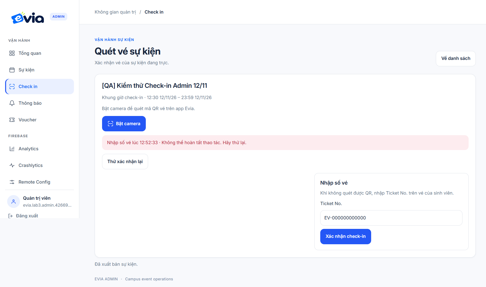 | 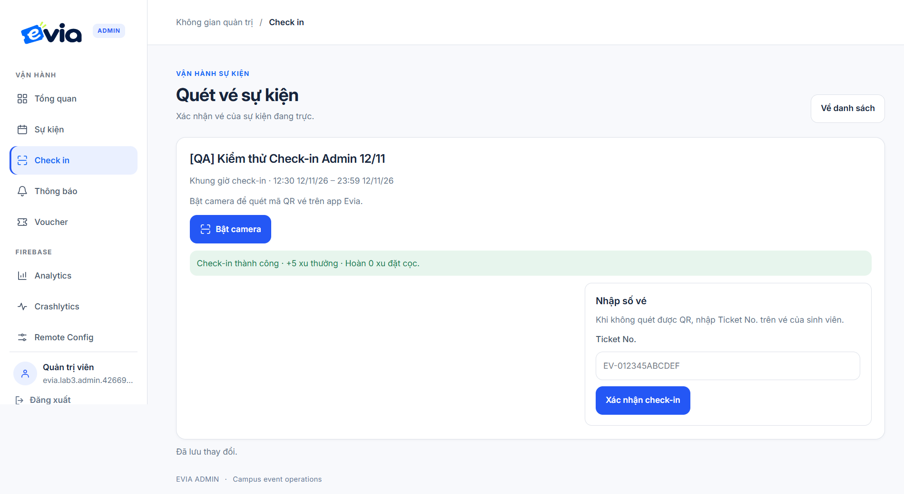 | 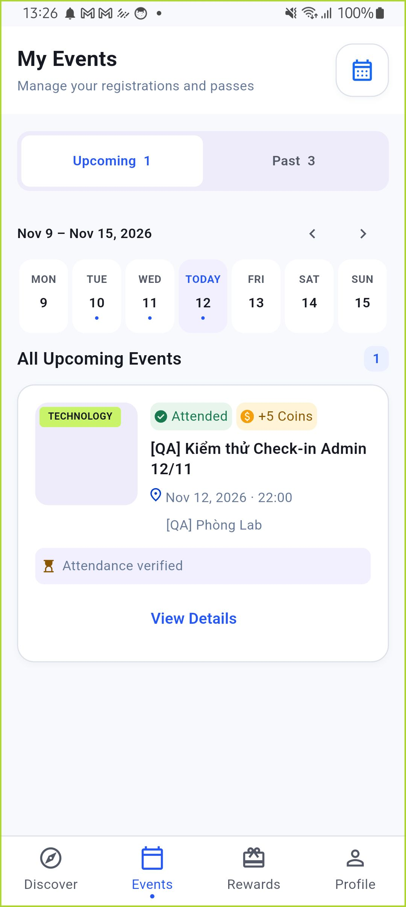 | 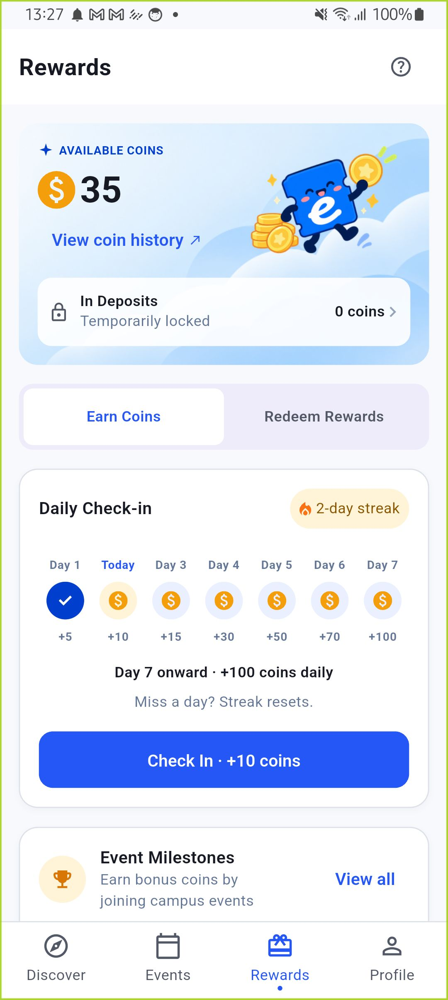 |

---

## 8. Phụ lục: Danh sách toàn bộ 41 ARTEMIS Traces ngày `2026-11-11`

> Đối soát trực tiếp từ `E:\Desktop\artemis\artemis\traces\<trace_id>\status.json` (`Start`/`End` theo múi giờ `+07:00`, tổng = **`4,665.1 giây`**).

| # | Trace ID (8 ký tự đầu) | Bắt đầu | Kết thúc | Thời lượng (s) | Model | Trạng thái trace | Phân loại / TC |
| --- | --- | --- | --- | ---: | --- | --- | --- |
| 1 | `f8832ee0` | `14:23:29` | `14:24:39` | `70.1` | Flash | completed | Pre-check trạng thái đầu phiên |
| 2 | `6a0643bd` | `14:25:13` | `14:26:14` | `61.3` | Flash | completed | Pre-check danh sách sự kiện/tài khoản |
| 3 | `2900b06d` | `14:29:18` | `14:31:46` | `147.4` | Flash | cancelled | `TC18` (phần 1: log out) |
| 4 | `4d0e5597` | `14:31:57` | `14:33:23` | `86.5` | Flash | completed | **`TC18` (hiệu lực — Auth Guard)** |
| 5 | `408dd619` | `14:33:55` | `14:34:40` | `45.2` | Flash | completed | **`TC02` (hiệu lực)** |
| 6 | `d50acf87` | `14:35:21` | `14:37:34` | `132.9` | Flash | completed | `TC04` (lần đầu) |
| 7 | `b8d939ac` | `14:38:41` | `14:39:51` | `70.0` | Flash | completed | **`TC04` (hiệu lực)** |
| 8 | `8d179375` | `14:40:22` | `14:41:25` | `62.6` | Flash | completed | **`TC01` (hiệu lực)** |
| 9 | `c3b37ab8` | `14:42:24` | `14:43:04` | `39.8` | Flash | completed | **`TC03` (hiệu lực)** |
| 10 | `8760190e` | `14:44:25` | `14:45:21` | `55.3` | Flash | completed | **`TC05` (hiệu lực)** |
| 11 | `5e599f06` | `14:46:08` | `14:49:34` | `206.2` | Flash | completed | **`TC06` (hiệu lực)** |
| 12 | `01913502` | `14:49:54` | `14:52:36` | `162.3` | Flash | completed | **`TC07` (hiệu lực — Save/Follow/Undo)** |
| 13 | `9c364333` | `14:55:08` | `14:56:16` | `67.7` | Flash | completed | **`TC07` (hiệu lực — Reload Verify)** |
| 14 | `065b49ce` | `14:56:40` | `15:03:53` | `432.8` | Flash | failed | `TC08` (dừng do đụng quota Free Tier) |
| 15 | `e4dddd4c` | `16:23:23` | `16:27:31` | `247.6` | Flash | cancelled | **`TC08` (hiệu lực — gửi form đăng ký)** |
| 16 | `90acf51c` | `16:28:11` | `16:30:25` | `134.1` | Flash | completed | **`TC08` (hiệu lực — xác minh vé & ví)** |
| 17 | `82809e4a` | `16:32:37` | `16:35:20` | `162.4` | Flash | completed | `TC09` (trước khi chỉnh hết vé) |
| 18 | `1c447dac` | `16:36:18` | `16:37:37` | `79.6` | Flash | failed | `TC09` (retry trước khi cập nhật cache) |
| 19 | `1df86f72` | `16:38:40` | `16:40:42` | `122.1` | Flash | completed | **`TC09` (hiệu lực)** |
| 20 | `b7e43924` | `16:48:52` | `16:50:13` | `81.1` | Flash | completed | **`TC11` (hiệu lực — mở QR vé)** |
| 21 | `dc7a050c` | `16:51:22` | `16:52:20` | `58.3` | Flash | completed | **`TC11` (hiệu lực — kiểm tra sau scan)** |
| 22 | `0cfbb0ef` | `16:53:23` | `16:58:09` | `286.5` | Flash | completed | **`TC10` (hiệu lực — đăng ký & hủy)** |
| 23 | `a53044a2` | `17:05:20` | `17:06:33` | `73.5` | Flash | completed | **`TC10` (hiệu lực — xác minh số dư & Past)** |
| 24 | `28a8e3d2` | `17:07:24` | `17:08:23` | `58.9` | Flash | completed | **`TC12` (hiệu lực)** |
| 25 | `fcc4064d` | `17:08:51` | `17:10:48` | `116.9` | Flash | completed | **`TC13` (hiệu lực)** |
| 26 | `31744963` | `17:11:11` | `17:11:57` | `46.0` | Flash | completed | **`TC14` (hiệu lực — nút disabled)** |
| 27 | `d4d52279` | `17:12:47` | `17:13:50` | `63.2` | Flash | completed | **`TC14` (hiệu lực — xác minh voucher không đổi)** |
| 28 | `50d8a6b7` | `17:14:41` | `17:16:00` | `79.3` | Flash | completed | **`TC15` (hiệu lực — local CSV OK, Storage FAIL)** |
| 29 | `51d316f5` | `17:17:01` | `17:17:47` | `46.1` | Flash | completed | **`TC16` (hiệu lực — before config)** |
| 30 | `f80afbe4` | `17:20:46` | `17:21:56` | `69.6` | Flash | completed | **`TC16` (hiệu lực — after live publish)** |
| 31 | `b11a22c3` | `17:24:12` | `17:26:09` | `117.1` | Flash | cancelled | `TC17` (chuẩn bị lần 1) |
| 32 | `23bbc0ca` | `17:29:40` | `17:31:22` | `102.7` | Flash | completed | **`TC17` (hiệu lực — I'm Going setup)** |
| 33 | `b6492dac` | `17:32:44` | `17:34:12` | `87.3` | Flash | cancelled | `TC17_foreground` (kéo shade lần 1) |
| 34 | `5dc350dd` | `17:34:39` | `17:35:47` | `67.8` | Flash | completed | **`TC17_foreground` (hiệu lực)** |
| 35 | `b753de0b` | `17:37:43` | `17:39:11` | `88.5` | Flash | completed | **`TC17_background` (hiệu lực)** |
| 36 | `c243ca29` | `17:42:53` | `17:44:35` | `101.4` | Flash | completed | **`TC17_terminated` (hiệu lực — tap shade cold start)** |
| 37 | `47cee4c9` | `17:45:37` | `17:46:32` | `54.6` | Flash | completed | **`TC17_terminated` (hiệu lực — verify Event Detail)** |
| 38 | `57000c9e` | `17:47:33` | `17:48:53` | `80.6` | Flash | completed | **`TC17_terminated` (hiệu lực — verify Inbox)** |
| 39 | `ac91fb8a` | `17:54:08` | `18:02:19` | `490.9` | Pro | completed | **`TC19` (hiệu lực — Pro offline & recovery)** |
| 40 | `22b0579b` | `18:06:02` | `18:06:49` | `46.2` | Flash | completed | **`TC19` (hiệu lực — kiểm tra viewport/cuộn)** |
| 41 | `94e8d1c9` | `18:09:01` | `18:10:04` | `62.7` | Flash | failed | **`TC19` (bấm `Thử lại`, xác nhận hồi phục bằng `adb` live)** |
